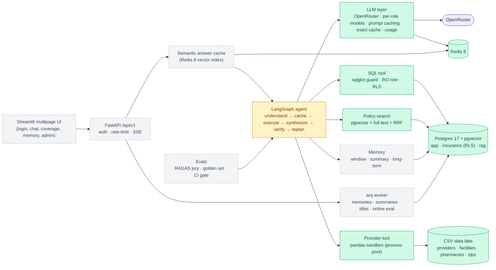

# HealthGuard Production Upgrade — Implementation Status

**Last updated:** 2026-10-10 (session 2: local continuation)  
**Branch:** `claude/vigilant-wozniak-f6rbb3`  
**Scope:** turn the HealthGuard demo (Groq + SQLite + ChromaDB + Streamlit) into a production-grade agentic RAG application on OpenRouter.

> **Read this first.** Work stopped partway through the plan, at the request to pause. **Phases 1–6 are done and committed** (foundation, database, synthetic data, LLM layer, RAG, tools). **Phase 7 (agent graph) has started**; only supporting modules exist. **Phases 7–14 are still to do.**
>
> Today the **data pipeline works end to end** (migrate → seed → ingest), and the tools work on their own. **The API and UI do not run right now**: `backend/main.py` is still the old file and imports modules that were removed, and the old Streamlit app was deleted before its replacement was written. See [Known gaps and broken items](#6-known-gaps-and-broken-items-right-now).

---

## 0. Session 2 progress (local continuation)

Work resumed locally (macOS, Docker Desktop, live `OPENROUTER_API_KEY`). The continuation plan runs the
remaining phases in this order: **P0 baseline → 7 → L0 live smoke → 9 → 8 → 10 → L1 → 12 → 14 → 11 → L2 → 13**.

| Step | Status | Notes |
|---|---|---|
| P0 Baseline | ✅ Done | `uv sync` on the locked toolchain; migrate + seed + ingest verified locally; `hg-models-check` passes against the live catalog (all 4 chat slugs exist); `backend/main.py` replaced by a minimal app factory (`/health/live`); ruff, format and mypy clean; `tests/` scaffold with 72 unit + 11 integration tests (SQL guard, sandbox, chunking, RRF, prompt-cache markers, usage, exact cache, JWT, guardrails, sources, registry, FakeLLM, RLS matrix, sandbox run, hybrid search) |
| P7 Agent graph | ✅ Done | `backend/agents/{planning,graph,runner}.py`, `nodes/{understand,cache_lookup,execute,synthesize,verify}.py`, `backend/cache/semantic.py`, `hg-chat` CLI; 32 graph/planning/cache unit tests + Postgres checkpointer and Redis 8 vector-cache integration tests |
| L0 Live smoke test | ✅ Done | First run against live OpenRouter; corpus re-embedded with `openai/text-embedding-3-small`; 8/8 persona scenarios answered, grounded and complete (see below) |

Fixes made in P0:
- `prefilter` member-ID check is case-insensitive (`m100004` was slipping through).
- `registry.spec_for` coerces plain strings to `Role` (a string role silently fell through to the judge model).
- `FakeLLM` can script exceptions (for failure-path tests).
- **Sandbox cold start no longer counts against the user-code timeout.** Spawning a worker (pandas import + CSV load) takes ~6 s, so the first provider query after a restart could hit the 10 s limit. New `sandbox.warm_up()` starts the pool with its own 120 s startup limit.
- `docker-compose.yml`: Postgres host port is configurable (`POSTGRES_HOST_PORT`, default 5432) for machines that already run a native Postgres.

P7 notes (design decisions beyond §4):
- `execute` runs each dependency level with `asyncio.gather` inside one node (the state has no reducers, so parallel LangGraph branches would conflict); each step has a wall-clock limit (`TOOL_STEP_TIMEOUT_SECONDS`).
- `planning.sanitize_plan` repairs untrusted plans (unknown tools, duplicate ids, forward/self/unknown dependencies, step budget); replan rounds prefix ids with `r{n}-`.
- `ToolResult.error_code` lets the graph tell a model outage (`llm_unavailable` fallback) from missing data (`no_data`).
- New outcome `insufficient` (answer replaced by the verifier); `VERIFY_REPLACE_UNGROUNDED=false` downgrades that to a log line.
- The verifier now sees recent conversation turns, and synthesis sees remembered preferences (style only). `PROMPT_VERSION` → `2026.10.2`.
- Semantic cache: RedisVL `AsyncSearchIndex` on a non-decoding client, index named after the embedding model + dimension; scope rules plus an identity check that moves a "public" answer mentioning the user to their member scope; only verified, fully successful turns are stored.
- `uv.lock` regenerated: it still listed `langchain-openai`, which `pyproject.toml` no longer declares.

### L0 live results (2026-10-10, `hg-chat`, exact + semantic caches off)

| Persona / scenario | Plan | Outcome | Cost |
|---|---|---|---|
| Maria — April knee MRI denial + appeal | sql ∥ policy_search | answered, grounded, complete; D002, $0 owed, appeal steps cited | $0.023–0.039 |
| James — Ozempic coverage + dermatology denial | sql, sql ∥ policy_search | answered; PA + step therapy, D010 referral, retro-referral window computed | $0.039–0.040 |
| Priya — delivery cost + HSA balance | sql ∥ policy_search | answered | $0.035–0.042 |
| Robert — out-of-network ER (No Surprises Act) | sql ∥ policy_search | answered | $0.022–0.039 |
| Aisha — external review process | policy_search | answered | $0.011 |
| David — family urgent care denial | sql ∥ policy_search | answered (D009) | $0.014–0.021 |
| David — in-network pediatrician with telehealth | providers (sandbox) | answered | $0.026 |
| Admin — top 5 denial reasons | sql | answered | $0.010 |
| Maria — 4-turn conversation | — | small talk; deductible ($2,700 of $3,400); "how much more before I hit it?" resolved to $700; "capital of France" blocked out-of-scope for $0.0002 | — |

**Provider prompt caching works:** repeating Maria's turn served 12,051 of 19,201 prompt tokens from cache (understand 4,750 / SQL 5,641 / synthesis and verify static prefixes) and cut the turn cost from $0.038 to $0.023 (−40 %).

**Bugs found and fixed by the live run:**
- `UserContext.load_member_profile` used `DATE :asof` with a bind parameter (invalid Postgres) — every member login would have failed. Fixed (`CAST(:asof AS date)`) and covered by an integration test.
- The verifier flagged the Member Services number and the data "as of" date as unsupported claims, replacing correct answers with the insufficient-context fallback. Fixed with a shared `REFERENCE_FACTS` block (contacts + as-of date) in both the synthesis and verify prompts, a stricter definition of a material claim, a `minor_issues` field, and a **one-shot revision**: an ungrounded draft is rewritten without the flagged claims and only replaced if it still fails (`MAX_REVISIONS`).
- The semantic cache never hit: it was keyed on the LLM's rewritten query, which differs on every run (measured cosine distance 0.18–0.30 between rewrites of the same question vs a 0.08 threshold). It is now keyed on the normalised raw message for self-contained first turns (rewrite only when the turn depends on history); members read their own scope before `public`; a turn whose rewrite mentions the user's plan or identity is stored privately. Live check: a second member asking the same general question got a cached, verified answer for $0.0002 instead of ~$0.01.
- Paraphrases of a question (distance ≥ 0.18 with this embedding model) do not hit at the 0.08 threshold — by design; the cache targets repeats.

## 1. Decisions confirmed with the user

| Area | Decision |
|---|---|
| LLM gateway | **OpenRouter** replaces Groq (the request said "grok"; the code used Groq) |
| Models | **Balanced tiers per role**, every one overridable by env var, with OpenRouter fallback routing |
| Eval judging | **Judge ensemble ("jury")** of models from different families |
| Frontend | **Upgraded Streamlit**: multipage, login, chat history, streaming, feedback, admin dashboards |
| Storage | **Postgres 17 + pgvector + Redis 8**, Alembic migrations, Docker Compose |
| Evaluations | **RAGAS offline** (golden set + CI gate) **plus online sampled LLM-judge scoring** |
| Auth | **Built-in JWT**: argon2, access tokens + rotating refresh tokens, roles `member` / `admin` |
| Mock data | **Member-scoped and public data**, with demo logins tied to member personas and isolation enforced by **Postgres Row-Level Security** |
| Caching | **Provider prompt caching** (OpenRouter `cache_control` / automatic) **plus a Redis semantic answer cache** |
| Delivery | One branch, phased commits |

### Model assignment (defaults in `backend/core/config.py`)

| Role (env var) | Used for | Default | Fallbacks |
|---|---|---|---|
| `MODEL_FAST` | understand (guardrail + rewrite + plan), verify, summaries, memory extraction, optional re-rank | `anthropic/claude-haiku-5.5` | `google/gemini-3.8-flash`, `openai/gpt-5.4-mini` |
| `MODEL_CODE` | SQL and pandas generation, self-correction | `anthropic/claude-sonnet-5.5` | `openai/gpt-5.4-mini` |
| `MODEL_SYNTH` | final streamed answer with citations | `anthropic/claude-sonnet-5.5` | `google/gemini-3.8-flash` |
| `EVAL_JUDGES` | offline RAGAS jury | `openai/gpt-5.4-mini`, `google/gemini-3.8-flash`, `anthropic/claude-haiku-5.5` | — |
| `ONLINE_EVAL_JUDGES` | sampled live scoring (deliberately non-Anthropic, so the judges differ from the synthesis model's family) | `openai/gpt-5.4-mini`, `google/gemini-3.8-flash` | — |
| `EMBEDDING_MODEL` | RAG, semantic cache, long-term memory | `openai/text-embedding-3-small` (1536-d) | `EMBEDDING_PROVIDER=local` or `hash` |

The slugs come from a web search (Oct 2026), not a live API check, because `openrouter.ai` is blocked in the build sandbox. `hg-models-check` verifies them against the live catalog.

---

## 2. Progress overview

| # | Phase | Status | Commit |
|---|---|---|---|
| 1 | Foundation: dependencies, settings, logging, telemetry, Docker, CI | ✅ Done (Docker image not yet built, see §6) | `d88c015` |
| 2 | Database: SQLAlchemy models, Alembic, pgvector, read-only role, RLS | ✅ Done and verified | `0dd227d` |
| 3 | Enhanced mock data, policy corpus, personas | ✅ Done and verified | `b66687d` |
| 4 | OpenRouter LLM layer, prompt caching, prompts, usage accounting | ✅ Done (offline-verified only) | `80fdde7` |
| 5 | RAG: chunking, ingestion, hybrid retrieval | ✅ Done (hash embedder only) | `a718a96` |
| 6 | Hardened tools: SQL guard + RLS execution, pandas sandbox, policy search | ✅ Done and verified | `a718a96` |
| 7 | Agent graph rewrite (LangGraph) | ✅ Done (session 2) | see §0 |
| 8 | Memory: history window, rolling summary, long-term memories | ⬜ Not started | — |
| 9 | Auth + API + semantic cache | ⬜ Not started (design settled) | — |
| 10 | Background worker (arq) | ⬜ Not started | — |
| 11 | Evaluations (RAGAS jury, online eval, golden set) | ⬜ Not started (APIs checked) | — |
| 12 | Streamlit multipage UI | ⬜ Not started (old UI removed) | — |
| 13 | Observability wiring, architecture diagrams, docs | ⬜ Telemetry module done; diagrams and docs not started | — |
| 14 | Test suite | ⬜ Not started (checks so far were ad-hoc scripts) | — |

### Target architecture and what exists



Legend: green = implemented, amber = in progress, grey dashed = pending. Data stores are green because the schema, seed and ingestion work.

---

## 3. What is done (in detail)

### Phase 1 — Foundation (`d88c015`)
- **`pyproject.toml`** — package renamed to `healthguard`. Groq, ChromaDB, rank-bm25 and the SQLite checkpointer were removed. Added Postgres/pgvector, Redis/RedisVL, arq, langgraph-checkpoint-postgres, sqlglot, pwdlib (argon2), PyJWT, structlog, Prometheus, OpenTelemetry, RAGAS 0.4.x and Faker. Ruff, mypy and pytest are configured. `uv.lock` was regenerated.
  - `langchain-community` is pinned `<0.4.2`, because RAGAS 0.4.3 imports a module that 0.4.2 removed.
- **`backend/core/config.py`** — pydantic-settings `Settings`: infrastructure URLs, auth, the per-role model registry, embeddings, caching flags and TTLs, agent limits, memory budgets, eval settings. With `ENV=production` it refuses to start with the default `JWT_SECRET` or without `OPENROUTER_API_KEY`.
- **`backend/core/logging.py`** — structlog with contextvars correlation (request, user, conversation and trace ids) and PII masking (emails, phone numbers, SSNs, dates).
- **`backend/core/telemetry.py`** — Prometheus counters and histograms (LLM tokens, cost and latency, cache events, tool outcomes, guardrail blocks, turn latency). OTLP tracing switches on when `OTEL_EXPORTER_OTLP_ENDPOINT` is set.
- **`backend/core/errors.py`** — `AppError` hierarchy and uniform JSON error handlers (not yet wired into an app).
- **`backend/core/redis.py`**, **`backend/core/tokens.py`** (tiktoken with an offline fallback estimate), **`backend/core/security.py`** (argon2id hashing, JWT access tokens, refresh-token generation and hashing).
- **Deployment files:**
  - `deploy/Dockerfile`: multi-stage uv build, non-root user, tiktoken encoding fetched at build time.
  - `docker-compose.yml`: postgres (pgvector/pg17), redis:8, a one-shot `migrate` job (alembic, then seed, then ingest), api, worker, ui, and Jaeger under the `observability` profile.
  - `Makefile`, `.env.example`.
- **CI:** `.github/workflows/ci.yml` (lint, format, mypy, unit tests, migrate + seed + ingest, integration tests, Docker build) and `.github/workflows/eval.yml` (nightly or manual RAGAS run with the `OPENROUTER_API_KEY` secret).

### Phase 2 — Database (`0dd227d`)
- **Three schemas:**
  - `app`: users, refresh_tokens, conversations, messages, feedback, user_memories (vector), traces, llm_calls, eval_runs, eval_results, online_eval_scores.
  - `insurance`: plans, plan_benefits, formulary, procedure/diagnosis/denial codes, members, member_accumulators, claims, pharmacy_claims, prior_authorizations.
  - `rag`: documents, chunks (pgvector HNSW index plus a generated `tsvector` with a GIN index), data_version.
- **Migration `0001_initial_schema.py`** (autogenerated, then hand-extended):
  - Creates the `vector` extension and the schemas.
  - Creates the **read-only `hg_agent_ro` role**: `search_path=insurance`, `statement_timeout`, `default_transaction_read_only=on`, SELECT-only grants on `insurance`.
  - **Revokes `set_config` from PUBLIC**, so a generated query cannot rewrite its own RLS context.
  - Adds **RLS policies** on the five member-scoped tables. A row is visible if `app.role = 'admin'`, or `member_id` or `subscriber_id` equals `app.member_id`.
- Upgrade, downgrade and re-upgrade were all verified against `pgvector/pgvector:pg17`.

### Phase 3 — Enhanced mock data (`b66687d`)
Deterministic (seed 42); `hg-seed` loads everything in about 3 seconds. **Actual counts at full scale:**

| Dataset | Rows | Notes |
|---|---|---|
| plans | 40 | Choice PPO / Core HMO / Select EPO / Saver HDHP × metal tier × Value/Standard/Plus; premiums, deductibles, OOP max, copays (NULL = deductible + coinsurance), Rx tiers 1–5, HSA flag, referrals, out-of-network coverage, availability by state |
| plan_benefits | 1,600 | 40 service categories per plan: cost text, copay or coinsurance, deductible flag, prior auth, visit limits |
| formulary | 117 | real drug names; tiers, prior auth, step therapy, quantity limits, specialty |
| procedure / diagnosis / denial codes | 56 / 38 / 12 | denial codes D001–D012 match the policy documents |
| members | 1,504 | families with spouses and children, PCP assignment, language, HSA balance |
| member_accumulators | 1,504 | deductible and OOP met vs. limit, individual and family |
| claims | 14,303 | adjudicated by `claims_engine.py` (copays, deductible, coinsurance, OOP cap, family accumulators, HMO referrals, EPO/HMO out-of-network denials, No Surprises Act emergencies, duplicates, pending/in_review). The plan estimated ~25k; actual volume is 14.3k |
| pharmacy_claims | 9,631 | condition-driven fills, prior-auth and step-therapy rejections, mail order |
| prior_authorizations | 195 | approved / denied / pending / withdrawn |
| providers.csv | 5,016 | 30 specialties, credentials, languages, networks, ratings, telehealth, geo, next availability |
| facilities.csv / pharmacies.csv / zip_centroids.csv | 442 / 433 / 240 | 40 cities in 21 states |
| policy corpus | 60 docs | 20 hand-written documents (~9k words) with tables generated from shared reference data, plus 40 generated plan Summaries of Benefits and Coverage (SBCs) |

The reference data, the claims engine, the plan benefits and the documents share one source of truth (`backend/data_gen/reference.py`), so SQL answers and policy text agree.

**Demo personas** (password = `DEMO_PASSWORD`, default `HealthGuard!2026`; demo only):

| Login | Member | Plan | Story |
|---|---|---|---|
| maria.garcia@demo.healthguard.dev | M100001, Austin TX | PPO-SLV-PLS | April knee MRI **denied D002** (no prior auth; in-network, so $0 owed); August MRI approved and paid; 10 PT visits; knee arthroscopy prior auth **pending**; deductible $2,700 of $3,400 met |
| james.chen@demo.healthguard.dev | M100002, Seattle WA | HMO-GLD-STD | Type 2 diabetes; Ozempic **rejected pending prior auth**, then approved; dermatology biopsy **denied D010** (no HMO referral) |
| priya.patel@demo.healthguard.dev | M100003, Brooklyn NY | HDHP-BRZ-PLS | Pregnant (due Nov 2026); prenatal care $0; genetic screening prior auth approved; delivery pre-certified; HSA balance $2,150 |
| robert.johnson@demo.healthguard.dev | M100004, Miami FL | PPO-SLV-STD | Out-of-network **ER visit covered under the No Surprises Act**; bypass surgery; **OOP max reached** ($8,500), later claims $0; duplicate claim **D004** |
| aisha.okafor@demo.healthguard.dev | M100005, Chicago IL | HMO-CAT-STD | Catastrophic plan: 3 free PCP visits, telehealth therapy paid toward the deductible, one pending claim |
| david.kim@demo.healthguard.dev | M100006 + spouse and 2 children, Denver CO | EPO-GLD-PLS | Family plan: well-child visits, strep urgent care, out-of-network urgent care **denied D009**, family accumulators |
| admin@demo.healthguard.dev | — | — | Admin role: RLS bypass for portfolio analytics |

### Phase 4 — LLM layer (`80fdde7`)
- **`backend/llm/client.py`** — `OpenRouterClient`:
  - `complete`, `structured` (JSON-schema response format → Pydantic, falls back to prompt-only JSON if the provider rejects `response_format`, one repair attempt) and `stream` (usage reported on the final chunk).
  - OpenRouter `models` fallback list, `usage.include`, SDK retries and timeouts, attribution headers.
  - Any OpenAI-compatible endpoint works via `LLM_BASE_URL`.
- **Prompt caching** — every prompt builder emits a large, stable system message flagged `cache=True`. `prepare_messages` turns flagged messages into `cache_control: {"type": "ephemeral"}` blocks for `anthropic/*` and `google/*` models (at most 4 breakpoints); OpenAI-family models cache automatically. Synthesis adds a second breakpoint after the conversation history. Cached and cache-write tokens are parsed from the usage data. Measured stable prefixes: understand ~2.6k, SQL ~3.2k, dataframe ~1.5k tokens.
- **`backend/llm/cache.py`** — Redis exact-match cache for temperature-0 calls. The key hashes model, fallbacks, messages, parameters and prompt version.
- **`backend/llm/usage.py`** — per-turn `UsageCollector` (contextvar) collecting tokens, cached tokens, cost and latency, and feeding Prometheus.
- **`backend/llm/embeddings.py`** — OpenRouter `/embeddings`, local sentence-transformers, and a deterministic `hash` embedder for offline CI. Query embeddings are cached in Redis.
- **`backend/llm/prompts/`** (version `2026.10.1`):
  - `understand`: scope + safety + coreference rewrite + dependency-aware plan in **one** FAST call, replacing the old three guardrail calls plus rewrite plus route.
  - `sql`, `dataframe`: generated from the data catalog in `backend/core/data_sources.py`.
  - `synthesize`: strict grounding, `[S#]` / `[D#]` citations.
  - `verify`: grounded + complete in one call.
  - `memory` (extraction, summary, title).
  - `schemas.py` holds the Pydantic output models.
- **`backend/llm/fake.py`** — scripted `FakeLLM` for offline tests.
- **`backend/scripts/models_check.py`** (`hg-models-check`) — checks configured slugs against OpenRouter's `/models` and `/embeddings/models`.

### Phase 5 — RAG (`a718a96`)
- **`backend/rag/chunking.py`** — markdown heading hierarchy becomes `section_path`. Paragraphs are packed to about 380 tokens with one-paragraph overlap. Long tables are split by rows with the header repeated.
- **`backend/rag/ingest.py`** (`hg-ingest`) — idempotent: only documents whose content hash changed are re-embedded; removed documents are deleted; any change bumps `rag.data_version`. Result: 60 docs → 433 chunks in 1.7 s with the hash embedder.
- **`backend/rag/retriever.py`** — pgvector cosine (HNSW) plus Postgres full-text search (an OR query over stemmed lexemes, ranked with `ts_rank_cd`), fused with RRF, with optional LLM re-ranking. Plan SBCs are searched only for the member's own plan or a plan ID named in the query, so 40 near-identical SBCs don't crowd out policy documents.

### Phase 6 — Hardened tools (`a718a96`)
- **`backend/agents/tools/sql_guard.py`** — sqlglot checks: one statement, SELECT/CTE/UNION only, table allow-list from the catalog (`insurance` only), allow-list for unknown functions, no INTO / FOR UPDATE / SET / COPY / DML / DDL / table-valued functions. Rows are capped by wrapping the original query text.
- **`backend/agents/tools/sql_tool.py`** — runs as `hg_agent_ro` in a `READ ONLY` transaction with `SET LOCAL app.role / app.member_id / statement_timeout`. Retries feed guard or database errors back to the model.
- **`backend/agents/tools/sandbox.py`** + **`dataframe_tool.py`** — AST validation (no imports, dunders, I/O, `eval`/`query`/`getattr`, `read_*`/`to_*` except a safe list), restricted builtins, **spawned process-pool workers** with an address-space rlimit and a wall-clock timeout (the pool is recycled after a timeout or crash), and `distance_miles` / `zip_location` helpers.
- **`backend/agents/tools/rag_tool.py`** — `policy_search`, returning chunk-level citation data.
- **`backend/agents/tools/base.py`** — `UserContext` (loads the member profile and dependents; builds profile and tool-context text), `ToolResult`, JSON conversion.

**Verified results** (ad-hoc scripts against the live Postgres container; not yet pytest):
- **SQL guard:** accepted 5/5 safe queries. Rejected 15/15 attacks: `set_config`, `pg_sleep`, `current_setting`, `dblink`, `app.users` (including inside a subquery), `pg_catalog`, multiple statements, DELETE, SELECT INTO, FOR UPDATE, SET, COPY, `generate_series`.
- **RLS:**
  - Maria sees only M100001.
  - David sees M100006–M100009 (his family).
  - Admin sees everyone.
  - An account with no member profile sees 0 rows.
  - Public tables are visible to everyone.
  - Database-level blocks confirmed: `set_config` → permission denied; `app` schema → permission denied; DELETE → read-only transaction error.
- **Sandbox:** a geo search and a count ran correctly. Blocked 8/8 escape attempts (import, `__class__`, `open`, `read_csv`, `to_csv`, `getattr`, `__bases__`, `.query`). An infinite loop was killed at 10 s and the pool recovered.

---

## 4. Work in progress — Phase 7 (agent graph)

Written, linted and importable, but **not yet wired into a graph or tested**:

| File | Purpose |
|---|---|
| `backend/agents/state.py` | `AgentState` TypedDict, plus `initial_state()` which resets every key each turn so nothing leaks from the previous checkpointed turn |
| `backend/agents/guardrails.py` | standard fallback replies (out of scope, prompt injection, other member's data, medical advice, self-harm, LLM unavailable, insufficient context, no data); a deterministic pre-filter (injection regexes, plus member IDs mentioned that are neither the user's nor their dependents') |
| `backend/agents/sources.py` | turns tool results into a labelled `<sources>` block (`[S#]` data, `[D#]` documents) and UI citations; `prior_context()` passes dependency outputs to dependent steps |
| `backend/agents/trace.py` | `emit()` (LangGraph custom stream events), `step()` trace records, `@traced` decorator (status event + OTel span + timing) |

### Remaining Phase 7 design (settled, not yet built)
- **Nodes** (planned as `backend/agents/nodes/`):
  1. `understand` — runs `prefilter` first, then a FAST `structured(Understanding)` call. A block goes to `finalize` with a fallback reply. An in-scope message with an empty plan is small talk and goes straight to `synthesize(no_tools=True)`. Otherwise go to `cache_lookup`. On a replan, include the verifier's feedback and skip the cache.
  2. `cache_lookup` — semantic cache keyed by `standalone_query`. Scope is `member:{id}` when member data is needed, otherwise `public` (`role:admin` for admins), filtered by `data_version` and `PROMPT_VERSION`. A hit goes to `finalize`.
  3. `execute` — topological levels of `plan[].depends_on`; each level runs with `asyncio.gather`; dependent steps get `prior_context`; step IDs are prefixed with the replan round. Emits a `tool` stream event per step.
  4. `synthesize` — `build_sources`, then `llm.stream(Role.SYNTH)` emitting `token` events (and `answer_reset` on a replan).
  5. `verify` — FAST `structured(Verification)`. Not grounded: replace the answer with `FALLBACKS["insufficient_context"]` and emit `answer_replaced`. Incomplete with `replans < MAX_REPLANS`: go to `replan`, then back to `understand`. Skipped for blocked, small-talk and cache-hit turns; a verifier failure counts as a pass and is logged.
  6. `finalize` — sets `outcome` and records the trace step. Persistence and cache storage happen in the chat service, not the graph.
- **`backend/agents/graph.py`** — build with `StateGraph(AgentState)` and compile with `AsyncPostgresSaver`. The checkpointer needs a psycopg `AsyncConnectionPool(kwargs={"autocommit": True, "prepare_threshold": 0, "row_factory": dict_row})` and `await checkpointer.setup()`; tests use `InMemorySaver`. `thread_id` = conversation id; deleting a conversation calls `adelete_thread`.
- **Streaming** — `graph.astream(state, config, stream_mode=["custom", "updates"])`, mapped to SSE events: `status`, `tool`, `token`, `answer_reset`, `answer_replaced`, `citations`, `final`, `error`.

---

## 5. Pending phases (not started)

### Phase 8 — Memory (`backend/memory/`)
- `context.py`:
  - Recent turns from `app.messages` after `conversation.summary_upto`, fitted to `HISTORY_TOKEN_BUDGET` with assistant messages truncated.
  - The conversation's rolling `summary`.
  - Top-k long-term memories by cosine similarity (`LONG_TERM_MEMORY_MIN_SIMILARITY`) when `user.memory_enabled`.
- `summarizer.py` — when tokens outside the window exceed `SUMMARY_TRIGGER_TOKENS`, summarize with the FAST model (`build_summary_messages`) and update `summary` / `summary_upto`.
- `long_term.py` — extract durable **non-clinical** preferences with `build_memory_messages`; skip a candidate if an existing memory has cosine > 0.9; store with an embedding. Users can list, delete and disable memories.

### Phase 9 — Auth, API, semantic cache
- **Rewrite `backend/main.py`** as an app factory:
  - Lifespan: Redis, the checkpointer pool, the arq pool, a sandbox warm-up and shutdown.
  - Middleware: request id, CORS allow-list, security headers, body-size cap.
  - Error handlers from `core/errors.py`, `/metrics` (prometheus-fastapi-instrumentator), OTel setup.
- **`backend/services/`**:
  - `auth_service`: register, login, refresh rotation with reuse detection (revoke the token family), logout.
  - `conversation_service`: CRUD and soft delete, plus checkpoint deletion.
  - `chat_service`: the per-turn pipeline:
    1. Ownership check.
    2. Persist the user message.
    3. Build context.
    4. Start usage collection.
    5. Stream the graph.
    6. Persist the assistant message, trace and `llm_calls`.
    7. Store a semantic-cache entry if the answer was verified.
    8. Enqueue worker jobs.
  - `coverage_service`: the member card.
  - `metrics_service`: admin aggregates.
- **Routers** (`backend/api/routers/`):
  - `/api/v1/auth/{register,login,refresh,logout,me}`
  - `/conversations` CRUD, plus `/conversations/{id}/messages` (JSON) and `/messages/stream` (SSE via sse-starlette)
  - `/messages/{id}/feedback`, `/me/memories`, `/me/coverage`
  - `/admin/{metrics/summary,evals/runs,evals/run,traces/{id}}`
  - `/health/live`, `/health/ready`
  - Rate limiting: Redis fixed window per user and per IP for auth.
- **Semantic cache** (`backend/cache/semantic.py`). RedisVL's `SemanticCache` expects a *synchronous* vectorizer, so the plan is to use `redisvl.index.AsyncSearchIndex` directly:
  - Schema: `query` text, `payload` text, `scope` / `data_version` / `prompt_version` tags, `embedding` vector (cosine).
  - Lookup with `VectorRangeQuery` (threshold `SEMANTIC_CACHE_DISTANCE_THRESHOLD`, tag filters); store with `index.load(..., ttl=...)`.
  - An in-memory implementation for tests. Member-scoped answers are never shared across users.

### Phase 10 — Worker (`backend/workers/`)
- arq `WorkerSettings`, matching the compose command `arq backend.workers.settings.WorkerSettings`.
- Tasks: `extract_memories`, `summarize_conversation`, `title_conversation`, `online_eval` (sampled at `ONLINE_EVAL_SAMPLE_RATE`, plus every thumbs-down), `run_offline_eval`.

### Phase 11 — Evaluations (`backend/evals/`)
- `build_golden.py` (`hg-build-golden`) — about 80 cases in `datasets/golden.jsonl`. Categories: plan SQL, provider search, policy RAG, member-scoped per persona, multi-hop, memory follow-ups, out of scope, prompt injection, cross-member probes, admin analytics. Numeric ground truths are computed from the seeded database.
- `run.py` (`hg-eval`) — runs each case through the chat pipeline as its persona and collects answer, contexts and tools.
- **RAGAS 0.4.3 collections API (checked):** `ragas.metrics.collections.{Faithfulness, AnswerRelevancy, ContextPrecisionWithReference, ContextRecall, FactualCorrectness}`, using `llm_factory(model, client=AsyncOpenAI(base_url=OpenRouter), adapter="instructor")` and `ragas.embeddings.OpenAIEmbeddings(client=...)`. Each metric is scored per judge in `EVAL_JUDGES`; the report shows mean and spread, and cases with spread > `JUDGE_DISAGREEMENT_THRESHOLD` are flagged.
- Deterministic checks: route accuracy, refusal accuracy, data isolation (no other member's identifiers in the answer), latency p50/p95, cost per query, cache hit rate.
- `thresholds.yaml` gate: faithfulness ≥ 0.85, relevancy ≥ 0.80, context recall ≥ 0.75, route accuracy ≥ 0.90, refusal = 1.0, isolation = 1.0. Results are written to `eval_runs` / `eval_results` and to `reports/<run>.md` / `.json`.

### Phase 12 — Streamlit UI (`frontend/`)
- `frontend/app.py` uses `st.navigation`, showing admin pages only to admins.
- `lib/api.py`: httpx client with token refresh and an SSE consumer; `BACKEND_URL` from env.
- `lib/ui.py`: badges, citations, trace renderer.
- Views:
  - Login / register.
  - Chat: conversation sidebar, streamed answers, citations, tool / cache / latency / cost badges, trace, `st.feedback`, persona quick prompts.
  - My Coverage, Memory.
  - Admin Evaluations, Admin Observability (latency, cost, prompt-cache hit ratio and tokens saved, semantic-cache hit rate, guardrail blocks, feedback, online-eval trend).

### Phase 13 — Observability, docs, diagrams
- Wire telemetry into the app (FastAPI instrumentation, SQLAlchemy, a span per node — the `@traced` decorator already exists).
- `docs/architecture.md` with Mermaid diagrams:
  1. system / container view
  2. agent graph
  3. streaming chat sequence
  4. ER diagram
  5. caching layers
  6. evaluation pipeline
  7. security / RLS boundary
- Render to SVG with `@mermaid-js/mermaid-cli` using the Chromium at `/opt/pw-browsers` (`make diagrams`, `docs/render_diagrams.sh`).
- Rewrite `README.md`, `DEMO_QUESTIONS.md` (persona-driven demo script) and `specs/*` (add a Milestone 10).

### Phase 14 — Tests (`tests/`)
- **Unit:** SQL guard, sandbox validator, chunker, RRF, JWT and refresh rotation, prompt cache markers, usage parsing, guardrail pre-filter, `build_sources`, semantic-cache scoping, graph flows with `FakeLLM` + `InMemorySaver` (routing, parallel plan, retry, verify/replan, block, streaming event order).
- **Integration** (Postgres + Redis): RLS isolation, auth API flow, conversation CRUD, deletion clearing checkpoints, seed + ingest smoke test.
- **Live** (`-m live`): one real OpenRouter turn per persona.

---

## 6. Known gaps and broken items right now

| Item | Impact | Fix (phase) |
|---|---|---|
| ~~`backend/main.py` is the **old** file~~ — replaced by a minimal app factory serving `/health/live` (P0) | Full API still missing | Phase 9 |
| Old `frontend/app.py` **deleted**; new UI not written | No UI | Phase 12 |
| `docker-compose.yml` `api` / `worker` / `ui` services point to code that doesn't exist yet | Only the `postgres` and `redis` services are verified; `migrate` depends on the unbuilt image | Phases 9, 10, 12 |
| `deploy/Dockerfile` never built | Image build unverified | Phase 13 |
| `pyproject.toml` scripts `hg-eval`, `hg-build-golden` point to missing modules | Those commands fail | Phase 11 |
| `.github/workflows/ci.yml`: lint, format, mypy and both test stages now pass locally (P0); Docker build still unverified | CI expected green except Docker job | Phase 13 |
| `README.md`, `DEMO_QUESTIONS.md`, `specs/*.md` still describe the old Groq / SQLite / Chroma system | Misleading docs | Phase 13 |
| ~~Nothing has run against live OpenRouter~~ — verified locally in L0 (slugs, prompt caching, answer quality on 8 scenarios); RAGAS scores still pending | — | Phase 11 |
| ~~Retrieval tested only with the `hash` embedder~~ — re-ingested with OpenRouter embeddings (L0) | Retrieval quality measured by RAGAS later | Phase 11 |
| tiktoken couldn't download its encoding in the sandbox; character-based estimate used | Chunk sizes approximate (Docker image pre-fetches the encoding) | — |
| ~~Tool verification was ad-hoc scripts~~ — ported to pytest (P0) | — | — |
| Minor data/doc mismatches: the $35 insulin cap is stated but not enforced by the claims engine (no insulin claims are generated); the cardiac-rehab doc says the first 36 sessions don't count toward the therapy limit while the engine counts them (no persona hits the limit) | Cosmetic | Phase 3 follow-up |
| RLS design choice: a subscriber sees dependents' records; a **spouse** who is not the subscriber sees only their own | Intended, but should be documented in the privacy doc | Phase 13 |

---

## 7. How to run what exists today

```bash
uv sync --all-groups

# Postgres (pgvector) + Redis 8
docker compose up -d postgres redis

# For offline work without OpenRouter, put these in .env:
#   EMBEDDING_PROVIDER=hash
#   JWT_SECRET=<any 32+ char string>

uv run alembic upgrade head    # schemas, RLS, read-only agent role
uv run hg-seed                 # ~3 s; or: hg-seed --scale small
uv run hg-ingest               # 60 docs → ~433 chunks

# With OPENROUTER_API_KEY set and network access to openrouter.ai:
uv run hg-models-check
```

Tools can be exercised directly from Python, e.g.:
- `backend.agents.tools.sql_tool.execute_scoped(validate_sql(...), UserContext(...))`
- `backend.agents.tools.sandbox.run_code(...)`, run from a script file, not stdin, because the workers are spawned
- `backend.rag.retriever.hybrid_search(...)`

---

## 8. What is needed from the project owner

1. **Network access to `openrouter.ai`** for the build environment (cloud environment settings → Network access → allowed domains), plus an **`OPENROUTER_API_KEY`**, to run live verification, prompt-cache measurement and RAGAS.
2. Confirmation of model choices once `hg-models-check` runs against the live catalog.
3. A go-ahead to continue with Phase 7 onward, in the order of §5.

## 9. Recommended next steps (in order)
1. Finish Phase 7: nodes and graph, with `FakeLLM` unit tests.
2. Phase 9: services, routers and the new `main.py`, so the API runs.
3. Phase 8 memory and Phase 10 worker.
4. Phase 12 Streamlit UI.
5. Phase 14 tests, to get CI green.
6. Phase 11 evals; run live once OpenRouter is reachable.
7. Phase 13 diagrams, README and specs; Docker build check.
