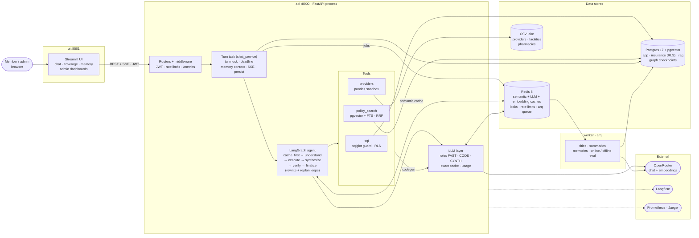
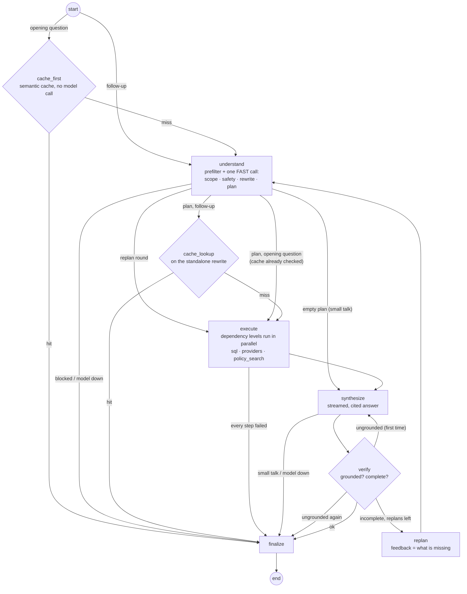
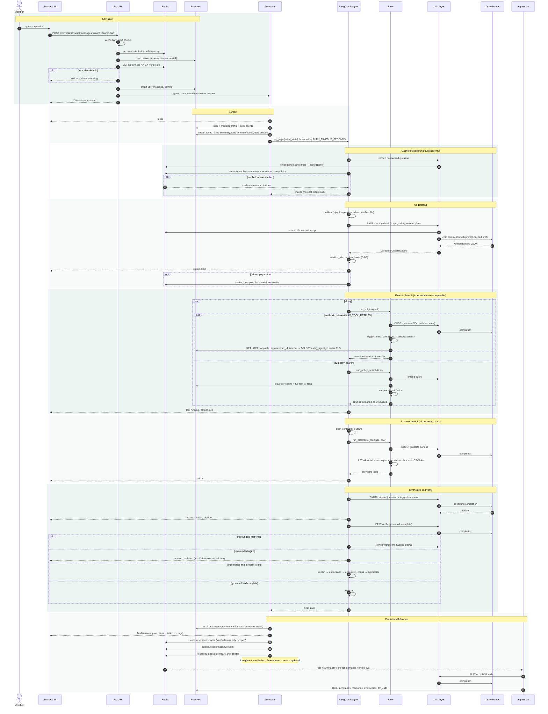
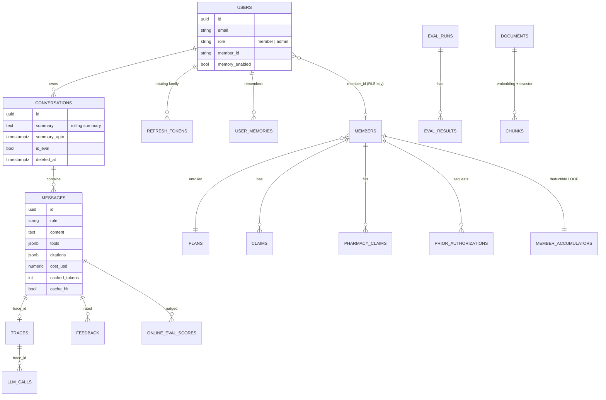
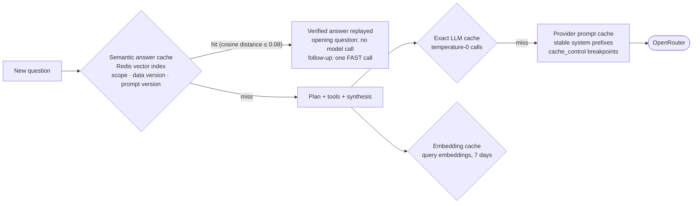
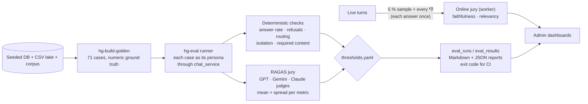
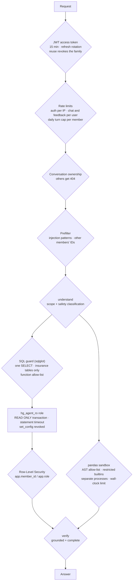

# HealthGuard architecture

HealthGuard is an agentic RAG assistant for health-insurance members. A LangGraph agent plans which tools to use (SQL over the member's records, pandas over the provider directory, hybrid search over policy documents), runs them in parallel, writes a cited answer, and verifies it before the member sees it. Every turn streams over Server-Sent Events, is persisted with a full trace, and is cost-accounted.

Diagrams render on GitHub. `make diagrams` also exports them as SVG to `docs/diagrams/`.

The reasoning behind each design choice (context, alternatives, trade-offs) is in the [architecture decision records](adr/README.md).

## 1. System view

Six containers (`ui`, `api`, `worker`, `migrate`, `postgres`, `redis`) plus external services. The LangGraph agent, its tools and the LLM layer all run inside the API process. Solid arrows are the request path; dotted arrows are telemetry.

- **Turn task** (`backend/services/chat_service.py`): takes the per-conversation Redis lock, loads the memory context, runs the graph under the turn deadline, persists the result and enqueues follow-up jobs.
- **Tools:** `sql` and `providers` generate code with the CODE model and self-correct on errors; `policy_search` is hybrid retrieval. A dependent step receives its prerequisites' output.
- **LLM layer:** maps roles to OpenRouter models with fallbacks, checks the exact LLM cache in Redis, marks stable prefixes for provider prompt caching, and records tokens and cost per call.
- **Redis** holds every piece of fast shared state: the semantic answer cache, the exact LLM and embedding caches, turn locks, rate limits and the arq queue.

## 2. Agent graph

- An opening question (no history or summary) is self-contained, so `cache_first` looks it up by its normalised text before any model call: the member's own scope first, then public answers. Messages the deterministic prefilter would block skip the lookup. A follow-up needs the planner's rewrite, so its lookup (`cache_lookup`) runs after `understand`.
- The state is reset on every turn (`initial_state`), so a checkpointed thread never carries one turn's results into the next. The Postgres checkpointer stores the final state per conversation (`thread_id` = conversation id).
- A whole turn is bounded by `TURN_TIMEOUT_SECONDS` (the chat service cancels the graph and answers with the `timeout` fallback).
- `planning.sanitize_plan` repairs the model's plan: it drops unknown tools and empty tasks, renames duplicate IDs, removes forward, self and unknown dependencies, and enforces the step budget.
- An ungrounded draft is rewritten once without the flagged claims. Only if the rewrite also fails is it replaced with the insufficient-context fallback.

## 3. A streamed chat turn

A member asks a question that needs two independent tool steps and one dependent step. Events the agent emits go through the turn task's queue to the SSE response; the diagram draws them straight to the UI for brevity. The login/refresh flow, admin endpoints and the offline eval runner are left out.

1. **Admission** is synchronous in the request: auth, rate limits, ownership and the turn lock. The user message is committed before any model call.
2. **Context.** The turn task loads the member profile and a token-budgeted memory context, then runs the graph under `TURN_TIMEOUT_SECONDS`. On timeout the graph is cancelled and the `timeout` fallback is saved.
3. **Cache-first.** Only an opening question is self-contained enough to look up before planning. A hit replays a verified answer with no chat-model call.
4. **Understand.** The deterministic prefilter runs first; one FAST call then classifies, rewrites and plans. The plan is untrusted and is repaired into a DAG.
5. **Execute.** Steps in the same dependency level run concurrently inside the one node. A dependent step gets up to 3,000 characters of each prerequisite's output; if a prerequisite failed, it is skipped.
6. **Synthesize and verify.** The answer streams token by token, then the FAST verifier checks it: one rewrite for ungrounded claims, one replan for missing parts.
7. **Persist and follow up.** Message, trace and per-call cost are saved in one transaction. Background jobs are queued only when they have work.

A client disconnect never cancels the turn task, so the answer is always persisted.

## 4. Data model (main tables)

There are three schemas. `app` holds identity, chat, memory, traces, usage and evals. `insurance` holds plans, members, claims and authorizations, with RLS on the member-scoped tables. `rag` holds documents, chunks and the data version.

## 5. Caching layers

| Layer | Key | Scope and safety | Measured effect |
|---|---|---|---|
| Semantic answer cache | Normalised raw message for an opening question (looked up before planning); the rewritten query when the turn depends on history (looked up after planning) | `public`, `member:{id}` or `role:admin`. Members read their own scope first. A turn whose answer or rewrite mentions the member's identity or plan is stored privately. Only verified, fully successful turns are stored. | A repeated general question cost $0.0002 instead of about $0.01 when planning ran first; an opening question now hits with no model call |
| Exact LLM cache | Hash of model, fallbacks, messages, params and prompt version | Byte-identical input only. Outputs that fail validation (bad JSON, SQL or pandas the guard, sandbox or database rejected) are dropped so they are never replayed | — |
| Provider prompt cache | Stable prompt prefixes (understand ≈ 4.9k tokens, SQL ≈ 5.8k) | Per provider | 54–60 % of planner and SQL prompt tokens served from cache; repeat turn −40 % cost |
| Embedding cache | Model + text hash | — | The cache key and the memory search embed the same normalised text, so one call serves both |

## 6. Evaluation

`hg-eval --dry-run` prints a cost estimate before anything runs, and every report shows the agent cost and the judge cost (summed from OpenRouter's per-call cost). Judge responses are cached on disk (`backend/evals/.cache/`), so re-running unchanged cases costs nothing. `eval.yml` is manual-only, and the admin API queues one run at a time.

## 7. Security boundaries

Notes:
- **RLS visibility.** A member sees their own rows. A subscriber also sees their dependents' rows. A spouse who is not the subscriber sees only their own. Admins see everything. An account with no linked member record sees no member rows.
- **Self-registration.** Self-registered accounts are never linked to member records, because linking requires identity verification. They can ask general plan and policy questions.
- **Sandbox memory limit.** The pandas sandbox enforces an address-space limit only on Linux, where it reads `/proc`. On macOS, development relies on the wall-clock timeout.
- **Long-term memory.** Memory stores only non-clinical preferences. A deterministic filter rejects IDs, amounts, dates, contact details and clinical terms, even when the extraction model proposes them.
- **Logs.** PII (emails, phone numbers, SSNs, dates, member IDs) is masked in structured logs, including values nested in lists and objects.
- **What members see.** Members get each answer's plan, steps, verification verdict and citations. The full trace and the generated SQL / pandas code go to admins only. Access tokens carry only the user id and role.

## Observability

- **Prometheus `/metrics`:** LLM tokens (prompt, completion, cached) and cost per role and model, LLM latency and errors, cache hits and misses per layer, tool outcomes, guardrail blocks, and turn latency. Run one uvicorn worker per container, because counters are per process.
- **OpenTelemetry** (set `OTEL_EXPORTER_OTLP_ENDPOINT`; `docker compose --profile observability` adds Jaeger): FastAPI, SQLAlchemy and httpx spans. There is also one span per graph node (`agent.*`) and one per LLM call (`llm.complete` / `llm.stream`), carrying the model, tokens, cached tokens and cost.
- **Per-turn trace:** each node's input, output, reasoning and timing are stored in `app.traces`, shown in the chat UI and in `GET /admin/traces/{id}`.
- **Admin dashboards:** latency percentiles, cost per turn, prompt-cache ratio, semantic-cache hit rate, outcomes, tools, feedback and online-eval scores.
