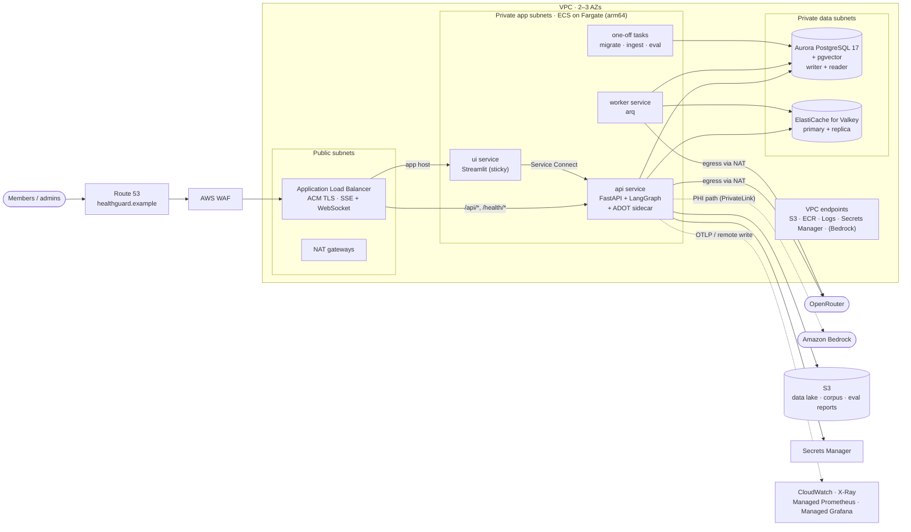
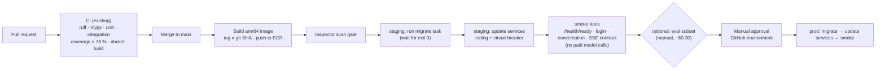

# HealthGuard on AWS: deployment architecture

> **Status: reference deployment design.** HealthGuard runs today with Docker Compose (locally and in CI). This document is the AWS target architecture: which service runs each component, why that service was chosen over the alternatives, how it's configured, and the exact code and configuration changes the move requires ([§20](#20-changes-required-before-the-first-deploy)). Prices are order-of-magnitude estimates for `us-east-1` and must be checked in the AWS Pricing Calculator.

Related: [architecture](../architecture.md) · [decision records](../adr/README.md) · [ADR-0037 packaging](../adr/0037-packaging-and-deployment.md) · [ADR-0039 AWS target](../adr/0039-aws-deployment-target.md) · [interview guide](../interview/INTERVIEW_GUIDE.md)

**Contents**

1. [At a glance](#1-at-a-glance)
2. [Design principles](#2-design-principles)
3. [Region, accounts and environments](#3-region-accounts-and-environments)
4. [Networking](#4-networking)
5. [Edge and ingress](#5-edge-and-ingress)
6. [Compute: ECS on Fargate](#6-compute-ecs-on-fargate)
7. [Database: Aurora PostgreSQL with pgvector](#7-database-aurora-postgresql-with-pgvector)
8. [Cache, locks and queue: ElastiCache for Valkey](#8-cache-locks-and-queue-elasticache-for-valkey)
9. [Object storage: S3](#9-object-storage-s3)
10. [Images: ECR](#10-images-ecr)
11. [Secrets and configuration](#11-secrets-and-configuration)
12. [The LLM gateway on AWS: OpenRouter now, Bedrock for PHI](#12-the-llm-gateway-on-aws-openrouter-now-bedrock-for-phi)
13. [Code-execution sandbox isolation](#13-code-execution-sandbox-isolation)
14. [Observability](#14-observability)
15. [Security and compliance](#15-security-and-compliance)
16. [CI/CD](#16-cicd)
17. [Scaling](#17-scaling)
18. [Resilience, backup and disaster recovery](#18-resilience-backup-and-disaster-recovery)
19. [Cost estimate](#19-cost-estimate)
20. [Changes required before the first deploy](#20-changes-required-before-the-first-deploy)
21. [Infrastructure as code](#21-infrastructure-as-code)
22. [Runbook essentials](#22-runbook-essentials)
23. [Interview questions on the deployment](#23-interview-questions-on-the-deployment)

---

## 1. At a glance



### Component → AWS service map

| Component (Compose today) | AWS service | One-line reason |
|---|---|---|
| `api` (FastAPI, SSE, LangGraph) | **ECS on Fargate** service behind an **ALB** | Long-lived SSE streams and one process per container; no servers or cluster control plane to run |
| `ui` (Streamlit) | ECS on Fargate service, ALB with **sticky sessions** | Streamlit keeps session state in process and uses WebSockets |
| `worker` (arq) | ECS on Fargate service, scaled on queue depth | Same image, independent scaling |
| `migrate` (alembic, seed, ingest) | **ECS one-off tasks** (`RunTask`) from the pipeline / EventBridge | Runs once per deploy or per corpus change, gates the rollout |
| `postgres` (pgvector/pg17) | **Aurora PostgreSQL 17** with pgvector, writer + reader | RLS, roles, pgvector and full-text are all supported; Multi-AZ storage, fast failover, a reader endpoint for agent queries |
| `redis` (Redis 8) | **ElastiCache for Valkey** (Multi-AZ, TLS) | Managed in-memory store for caches, locks, rate limits and the arq queue; vector search for the semantic cache (compatibility gate in [§8](#8-cache-locks-and-queue-elasticache-for-valkey)) |
| `hg-data` volume (CSV lake, corpus) | **S3** (versioned, KMS) | Durable, cheap, read-only data; synced into each task at start |
| Image registry | **ECR** (immutable tags, scan on push) | Private, IAM-integrated, close to Fargate |
| `.env` | **Secrets Manager** (secrets) + **SSM Parameter Store** (config) | Encrypted, audited, injected into task definitions |
| OpenRouter | OpenRouter over **NAT** egress; **Amazon Bedrock** for real PHI | Keep provider choice; Bedrock keeps PHI inside AWS under the BAA |
| Prometheus `/metrics` | **ADOT collector sidecar** → **Amazon Managed Service for Prometheus** → **Amazon Managed Grafana** | Scrapes each task on localhost; `/metrics` never exposed publicly |
| OTLP → Jaeger | ADOT sidecar → **AWS X-Ray** | The app already exports OTLP; only the endpoint changes |
| Logs (stdout JSON) | **CloudWatch Logs** (awslogs driver) | Zero agent setup; structlog already emits JSON |
| GitHub Actions CI | GitHub Actions + **IAM OIDC** role; deploy to ECS | No long-lived AWS keys in GitHub |
| — | **AWS WAF**, **GuardDuty**, **Security Hub**, **CloudTrail**, **Config**, **Inspector**, **KMS** | Edge protection, threat detection, audit, posture, image CVEs, encryption keys |

---

## 2. Design principles

1. **Map Compose one-to-one onto managed services.** Each Compose service becomes one ECS service or task with the **same image**; Postgres and Redis become managed equivalents. No re-architecture is needed to deploy, which keeps the AWS move low-risk.
2. **Managed over self-run** where the managed service supports what the app needs (RLS, pgvector, Redis protocol). Operating databases is not where this project adds value.
3. **Private by default.** Only the ALB is public. Containers, the database and the cache live in private subnets; AWS APIs are reached through VPC endpoints.
4. **Least privilege per service.** Separate IAM task roles, security groups and database roles for API, worker, UI and jobs. The UI can reach only the API.
5. **HIPAA-eligible building blocks.** Every AWS service listed is on AWS's HIPAA-eligible services list (verify the current list before relying on it), so the platform doesn't block a future PHI deployment. The non-AWS dependency (OpenRouter) has a Bedrock replacement path.
6. **Security controls stay in the app and the database**, as designed: AWS adds layers (WAF, network isolation, KMS), it doesn't replace RLS, the SQL guard or the sandbox.
7. **Everything as code** (Terraform), with separate state per environment.

---

## 3. Region, accounts and environments

| Decision | Choice | Why |
|---|---|---|
| Region | **`us-east-1`** (N. Virginia) | A US insurer keeps member data in the US; widest service and Bedrock model availability; lowest list prices. `us-west-2` is the DR region. |
| Accounts | **AWS Organizations** with separate `dev`, `staging`, `prod` accounts (+ `security`/log-archive and `shared` for ECR) | Hard blast-radius boundary between environments; SCPs can deny disabling CloudTrail or leaving approved regions |
| Environments | `dev` (cheap, single AZ, scales to zero at night), `staging` (prod-shaped, smaller), `prod` (Multi-AZ, WAF, alarms) | Staging catches config and migration problems before prod |
| Data | **Synthetic data only** in dev and staging; `hg-seed` never runs in prod | Real data never leaves prod |

---

## 4. Networking

### VPC layout (per environment)

| Tier | Subnets | Contents | Route |
|---|---|---|---|
| Public | one per AZ | ALB, NAT gateways | Internet gateway |
| Private app | one per AZ | ECS tasks (api, ui, worker, jobs) | Default route → NAT in the same AZ |
| Private data | one per AZ | Aurora, ElastiCache | No internet route at all |

- **2 AZs in dev/staging, 3 in prod.** Aurora storage is replicated across 3 AZs regardless.
- **CIDR:** a `/16` per environment (e.g. `10.20.0.0/16` for prod) with `/20` subnets leaves room to grow.

### NAT gateways

- **Why needed:** containers must call OpenRouter (external HTTPS) and pull from public endpoints that have no VPC endpoint.
- **One NAT per AZ in prod** so losing an AZ doesn't cut egress for the others; **one shared NAT in dev** to save cost.
- NAT data processing is billed per GB; the VPC endpoints below keep AWS-bound traffic (images, logs, S3) off the NAT.

### VPC endpoints

| Endpoint | Type | Why |
|---|---|---|
| S3 | Gateway (free) | Data lake / corpus sync, eval reports, ECR image layers |
| ECR API + ECR DKR | Interface | Image pulls without NAT; private |
| CloudWatch Logs | Interface | Log shipping without NAT |
| Secrets Manager | Interface | Secret retrieval at task start, private |
| SSM | Interface | Parameter Store config |
| `bedrock-runtime` | Interface (PHI path only) | Model traffic never leaves the AWS network (PrivateLink) |
| X-Ray / AMP (`aps-workspaces`) | Interface | Telemetry export without NAT |

### Security groups (the network form of least privilege)

| SG | Inbound from | Port | Notes |
|---|---|---|---|
| `sg-alb` | Internet (WAF in front) | 443 | 80 redirects to 443 |
| `sg-api` | `sg-alb`, `sg-ui` | 8000 | UI reaches the API via Service Connect |
| `sg-ui` | `sg-alb` | 8501 | |
| `sg-worker` | none | — | Outbound only |
| `sg-jobs` | none | — | Migrate / ingest / eval tasks |
| `sg-aurora` | `sg-api`, `sg-worker`, `sg-jobs` | 5432 | **Not** `sg-ui`: the UI never touches the database |
| `sg-cache` | `sg-api`, `sg-worker` | 6379 | TLS |

Egress from app SGs is limited to 443 (NAT/endpoints), 5432 and 6379.

---

## 5. Edge and ingress

### Route 53 + ACM

- Hosted zone `healthguard.example`; `app.` (UI) and `api.` (API) as **alias A/AAAA records** to the ALB.
- **ACM** public certificates on the ALB, DNS-validated, auto-renewed.

### AWS WAF (on the ALB)

| Rule | Purpose |
|---|---|
| AWS managed **Core rule set** and **Known bad inputs** | Generic web attacks |
| **Rate-based rule** per IP (e.g. 1,000 requests / 5 min) | Coarse flood protection in front of the app's per-user limits |
| **Size constraint** on the body (64 KB) | Mirrors the app's `BodySizeLimitMiddleware` at the edge |
| Block `/metrics` from the internet | Closes the "unauthenticated `/metrics`" open item; Prometheus scrapes on localhost instead |
| Optional geo match (US only) | A US insurer's member portal |

> **Tuning note:** the managed **SQL-injection rule set** inspects request bodies, and members legitimately type words like "delete" or "update my address". Start it in **count mode**, review matches, and scope it away from the chat message field. The real SQL defences are in the app ([ADR-0016](../adr/0016-defence-in-depth-for-generated-sql.md)).

### Application Load Balancer

| Setting | Value | Why |
|---|---|---|
| Listeners | 443 (TLS 1.2+ policy), 80 → 301 to 443 | |
| Routing | Host `api.*` → `tg-api`; host `app.*` → `tg-ui`; path `/metrics` → fixed 403 | Two hostnames on one ALB |
| **Idle timeout** | **300 s** | A turn may stream for up to 150 s. SSE pings every 15 s already keep the connection active, so this is a safety margin |
| **Stickiness** on `tg-ui` | Load-balancer cookie, 1 day | Streamlit keeps each session in one process's memory; without stickiness, a second replica would lose the session |
| WebSockets | Native on ALB | Streamlit's browser ↔ server channel |
| Health check `tg-api` | `GET /health/live`, 200, interval 15 s | **Liveness, not readiness.** `/health/ready` checks Postgres and Redis, so using it here would take *every* target out of service during a brief Redis blip. Readiness is used by the deploy smoke test instead |
| Health check `tg-ui` | `GET /_stcore/health` | Streamlit's built-in endpoint |
| Deregistration delay | 110 s | Lets in-flight streams finish within Fargate's 120 s stop window ([§6](#graceful-shutdown-and-the-120-second-limit)) |
| Access logs | To an S3 log bucket | Audit and debugging |

**Why ALB rather than API Gateway:** API Gateway's integration timeouts and response handling are built for short request/response calls; HealthGuard's turns stream for up to 150 s and the UI needs WebSockets with sticky sessions. ALB streams natively, supports WebSockets and stickiness, and costs less at steady load. Authentication stays in the app (JWT), so API Gateway's authorisers aren't needed.

**Why no CloudFront for the API:** nothing is cacheable (personalised, POST, streamed), and every hop is another timeout to tune for SSE. CloudFront in front of the UI's static assets is an optional later optimisation.

### Client IPs behind the ALB

The app rate-limits login per IP using `request.client.host`. Behind an ALB that is the **ALB's** address, so every user would share one bucket. The Dockerfile already runs uvicorn with `--proxy-headers`; uvicorn must also be told to trust the ALB with **`FORWARDED_ALLOW_IPS=*`**. That's safe only because `sg-api` accepts traffic solely from the ALB and the UI ([§20](#20-changes-required-before-the-first-deploy)).

---

## 6. Compute: ECS on Fargate

### Why ECS on Fargate

| Option | Verdict | Reasoning |
|---|---|---|
| **ECS on Fargate** | **Chosen** | Runs the existing image unchanged. No nodes to patch, no control plane to operate. Each task is a Firecracker microVM, which is also a good isolation boundary for the code sandbox ([§13](#13-code-execution-sandbox-isolation)). Fits "one process per container, scale with replicas" ([ADR-0037](../adr/0037-packaging-and-deployment.md)). |
| EKS | Not now | Worth it when an organisation already runs Kubernetes or needs its ecosystem (operators, service mesh). For four services it adds a control plane, upgrades and node management with no product benefit. The same image would move to EKS unchanged. |
| Lambda | No | Turns stream for up to 150 s over SSE, keep in-process state (sandbox pool, connection pools, background turn tasks), and the sandbox spawns processes. That's a poor fit for per-invocation functions. |
| App Runner | No | Simpler, but less control over networking, sidecars (ADOT), stickiness and one-off tasks. |
| ECS on EC2 | Later, maybe | Cheaper at sustained high utilisation (reserved/Graviton instances), but brings back node management. Re-evaluate at scale. |

**CPU architecture: arm64 (Graviton).** Fargate on ARM costs about 20 % less per vCPU-hour, and every dependency (pandas, numpy, asyncpg, pgvector client, tiktoken) ships arm64 wheels. Build with `docker buildx --platform linux/arm64`. One caveat: CI must test the arm64 image, not only amd64.

### Services and tasks

| Name | Kind | Command | vCPU / memory (prod start) | Count | Notes |
|---|---|---|---|---|---|
| `api` | Service | `uvicorn backend.main:app --workers 1 --proxy-headers` | 1 vCPU / 3 GB | min 2, max 10 | Hosts the pandas sandbox pool (2 workers × ~1 GB limit) in phase 1, hence 3 GB. ADOT sidecar (0.25 vCPU / 512 MB). |
| `worker` | Service | `arq backend.workers.settings.WorkerSettings` | 0.5 vCPU / 2 GB | min 1, max 4 | Runs offline evals too (3 h job timeout). |
| `ui` | Service | `streamlit run frontend/app.py …` | 0.5 vCPU / 1 GB | min 2, max 4 | Sticky sessions. `BACKEND_URL` = the API's Service Connect name. |
| `migrate` | One-off task | `alembic upgrade head` | 0.5 / 1 GB | 1 | Runs before each rollout; the pipeline waits for exit code 0. |
| `ingest` | One-off task | `hg-ingest` | 0.5 / 1 GB | 1 | Triggered when the corpus in S3 changes (EventBridge → `RunTask`). |
| `eval` | One-off task (optional) | `hg-eval …` | 1 / 2 GB | 1 | Manual; or via the admin UI through the worker. |
| `seed` | One-off task, **dev/staging only** | `hg-seed` | 1 / 2 GB | 1 | Never in prod. |

- **Ephemeral storage:** default 20 GB is plenty. The CSV lake and corpus are a few MB, synced from S3 at start-up.
- **Container health checks** are defined in each **task definition** (ECS ignores the Dockerfile's `HEALTHCHECK`, which targets port 8000 for every role). `api`: curl `/health/live`; `ui`: `/_stcore/health`; `worker`: none (arq has no HTTP endpoint), relying on ECS restarting a dead process plus a queue-depth alarm.
- **ECS Service Connect** gives the UI a stable internal name for the API (`http://api:8000`) without going back out through the ALB, with connection metrics for free.
- **ECS Exec** is disabled in prod (or enabled only with CloudTrail auditing and a break-glass role).

### Graceful shutdown and the 120-second limit

Fargate sends `SIGTERM` and waits at most **120 s** (`stopTimeout` maximum) before `SIGKILL`. Today a turn may run 150 s (`TURN_TIMEOUT_SECONDS`) and the lifespan waits 30 s for in-flight turns (`drain_background`). On AWS:

- set `stopTimeout = 120`, ALB deregistration delay = 110 s;
- lower `TURN_TIMEOUT_SECONDS` to ~100 s and raise the drain grace to ~105 s (a small code change: the grace is currently a hard-coded default), so in-flight turns finish and persist during deploys;
- anything still running when the task dies loses only that turn; its conversation lock expires on its own after the turn timeout + 30 s.

---

## 7. Database: Aurora PostgreSQL with pgvector

### Why Aurora PostgreSQL

| Option | Verdict | Reasoning |
|---|---|---|
| **Aurora PostgreSQL-Compatible 17** | **Chosen** | Everything the design depends on is supported: roles, `GRANT`, `SET LOCAL`, read-only transactions, **Row-Level Security**, `pgvector` with **HNSW**, full-text search. Storage is replicated six ways across 3 AZs; failover to a replica is typically well under a minute; a **reader endpoint** gives the agent's read-only queries their own instance. |
| RDS for PostgreSQL (Multi-AZ) | Good, cheaper alternative | Also supports everything above. Slower failover and readers are separate replicas. A sensible choice for dev, or if Aurora's I/O-heavy pricing doesn't suit the workload. |
| Self-managed Postgres on EC2 | No | Patching, backups and failover become our job. |
| DynamoDB / DocumentDB | No | No RLS, no SQL for the text-to-SQL tool, no joins. |
| OpenSearch for vectors | No | A second store for ~434 chunks; loses single-transaction writes and RLS ([ADR-0005](../adr/0005-postgres-pgvector-single-system-of-record.md)). |

**Capacity mode:**
- **prod:** provisioned `db.r7g.large` writer + one reader (Graviton, memory-optimised for HNSW and buffer cache). Predictable latency and cost.
- **dev/staging:** **Aurora Serverless v2** with a low minimum (dev can scale to 0 ACUs and auto-pause when idle), so idle environments cost almost nothing.

### Configuration

| Setting | Value | Why |
|---|---|---|
| Engine | Aurora PostgreSQL 17.x (latest supported minor) | Matches `pgvector/pgvector:pg17` in Compose and CI |
| Extensions | `vector` (pgvector with HNSW) | Created by the bootstrap step |
| Parameter group | `rds.force_ssl = 1`; `log_min_duration_statement = 1000`; `shared_preload_libraries` incl. `pg_stat_statements`; `idle_in_transaction_session_timeout` as a backstop | Encrypted connections only; slow-query visibility |
| Encryption | KMS customer-managed key at rest; TLS in transit | Compliance; key policy controls who can decrypt snapshots |
| Backups | 14-day automated backups with point-in-time recovery; daily snapshot copied to `us-west-2` | [§18](#18-resilience-backup-and-disaster-recovery) |
| Monitoring | Performance Insights / Database Insights, Enhanced Monitoring | Find expensive generated SQL quickly |
| Deletion protection | On in prod | |
| IAM DB auth | Not used | Short-lived tokens complicate the asyncpg/psycopg pools and the RLS role model; Secrets Manager with rotation instead |

### Database roles on a managed service (important)

On Aurora/RDS the master user is **`rds_superuser`, not a true superuser**. Today the app migrates and runs as one owner role (`healthguard`), and the RLS policies apply only `TO hg_agent_ro`. Because a **table owner bypasses RLS**, the app's own reads of `insurance.members` (e.g. loading the member profile) work. This has to be preserved.

| Role | Used by | Privileges | Where its secret lives |
|---|---|---|---|
| Master (`postgres`) | **Bootstrap only** (and break-glass) | `rds_superuser` | Secrets Manager, managed by RDS, rotation on |
| `healthguard_owner` | `migrate` task, `api`, `worker` | Owns `app`, `insurance`, `rag`; `CREATEROLE` (so the migration can create `hg_agent_ro`) | Secrets Manager, rotation on |
| `hg_agent_ro` | The agent's read-only pool only | Created by the migration: `USAGE` on `insurance`, `SELECT` only, read-only defaults, RLS applies | Secrets Manager; rotation must re-run `ALTER ROLE … PASSWORD` (the migration already does this) |

**One-time bootstrap** (run as master by a `bootstrap` task): `CREATE EXTENSION vector; CREATE ROLE healthguard_owner LOGIN CREATEROLE …; CREATE SCHEMA … AUTHORIZATION healthguard_owner;`. After that, `alembic upgrade head` runs as the owner (`CREATE EXTENSION IF NOT EXISTS` is a no-op).

**Verify on Aurora before go-live:** the migration runs `REVOKE EXECUTE ON FUNCTION pg_catalog.set_config(…) FROM PUBLIC`. `set_config` is owned by the platform's internal superuser, and `rds_superuser` may not be allowed to revoke it. If it can't, the protection still holds through two other layers: the SQL guard's function allow-list rejects `set_config`, and the prefilter blocks `set_config(` in messages ([ADR-0016](../adr/0016-defence-in-depth-for-generated-sql.md)). The trade-off should be recorded either way.

**Future hardening:** split runtime from ownership (a non-owner `healthguard_app` role with explicit grants and its own RLS policies or `BYPASSRLS` scoped to the app's queries). That's a deliberate code-and-policy change, not part of the first deploy.

### Read routing

| Traffic | Endpoint | Why |
|---|---|---|
| App reads/writes, checkpointer, worker | **Writer** (cluster endpoint) | Writes and read-your-writes |
| Agent's generated SQL (`hg_agent_ro`) and coverage card | **Reader** endpoint | Read-only, RLS-scoped, potentially expensive; isolating it protects write latency. RLS and `SET LOCAL` work in read-only transactions on replicas. Replica lag (typically milliseconds on Aurora) is acceptable for claim history. |

This needs one code change: the agent pool currently derives its host from `DATABASE_URL`, so add an `AGENT_DATABASE_HOST` (or full `AGENT_DATABASE_URL`) setting ([§20](#20-changes-required-before-the-first-deploy)).

### Connections

- Budget: each `api` task opens up to 20 SQLAlchemy connections (pool 10 + overflow 10), up to 10 agent connections and up to 10 checkpointer connections. At 10 API tasks that's ~400 worst case, within a `db.r7g.large`'s limits but worth an alarm on `DatabaseConnections`.
- **RDS Proxy: not at first.** Two things need testing before putting it in the path: connection **pinning** (session-level `SET` and prepared statements pin connections; asyncpg uses prepared statements; the checkpointer already disables them with `prepare_threshold=0`), and whether `SET LOCAL` keeps multiplexing at transaction boundaries. Add it (or PgBouncer in **transaction** mode, which is compatible with `SET LOCAL`) when task counts grow.

---

## 8. Cache, locks and queue: ElastiCache for Valkey

### What lives there

Semantic answer cache (vector index), exact LLM cache, embedding cache, rate-limit counters, the per-conversation turn lock, and the arq job queue ([ADR-0006](../adr/0006-redis-shared-fast-state.md)).

### Why ElastiCache for Valkey

| Option | Verdict | Reasoning |
|---|---|---|
| **ElastiCache for Valkey** (8.x with vector search) | **Chosen, behind a compatibility gate** | Managed, Multi-AZ with automatic failover, TLS, RBAC, HIPAA-eligible, cheaper than the Redis OSS engine on ElastiCache. Speaks the Redis protocol, so arq, rate limits and locks work unchanged. |
| Amazon MemoryDB | Alternative | Durable (multi-AZ transaction log) and has vector search. Pays for durability the workload doesn't need: everything here is a cache or best-effort work. |
| Redis Cloud (AWS Marketplace) | Alternative | Exact Redis 8 Query Engine parity with Compose; another vendor contract and data processor. |
| Semantic cache in pgvector, plain ElastiCache for the rest | **Fallback** | Removes the vector-search dependency from the cache tier entirely. |

**The compatibility gate.** The semantic cache uses RedisVL against Redis 8's Query Engine: `FT.CREATE` with TAG fields and a FLAT cosine vector field, KNN queries with tag filters, and per-key TTLs. Valkey's vector search implements the same command family, but parity must be proven, not assumed. The gate: run the integration suite's Redis vector-cache tests against a staging ElastiCache cluster. If anything differs, swap the backend. The cache sits behind a `SemanticCache` protocol with two implementations already, so a pgvector-backed adapter is a contained change, with no impact on the agent.

### Configuration

| Setting | Value | Why |
|---|---|---|
| Topology | **Cluster mode disabled**: one primary + one replica in another AZ; Multi-AZ automatic failover | The app uses database 0 and multi-key operations; a single shard is plenty for this data volume |
| Node type | `cache.t4g.medium` (dev/staging), `cache.r7g.large` (prod) | Memory-optimised for the vector index and caches |
| Encryption | In transit (TLS) and at rest (KMS) | `REDIS_URL` becomes `rediss://…` |
| Auth | RBAC user + password from Secrets Manager | |
| **Eviction policy** | **`volatile-lru`** (Compose uses `allkeys-lru`) | Under memory pressure, `allkeys-lru` could evict the **arq queue** (a sorted set without a TTL). `volatile-lru` only evicts keys with a TTL: caches, counters and locks, all of which tolerate eviction. |
| Persistence | None (no snapshots needed) | Everything is rebuildable; the database is the source of truth |
| Alarms | `DatabaseMemoryUsagePercentage` > 75 %, `Evictions` > 0 sustained, `CurrConnections`, replication lag | |

**At scale:** split into two clusters, one for the queue + locks + rate limits, and one for caches, so a cache memory spike can never touch the queue.

---

## 9. Object storage: S3

| Bucket | Contents | Access | Settings |
|---|---|---|---|
| `hg-<env>-data` | `lake/*.csv` (providers, facilities, pharmacies, zip centroids), `corpus/*.md` (policy documents) | `api`, `worker`: read `lake/`; `ingest`: read `corpus/` | Versioning, SSE-KMS, Block Public Access, bucket policy restricted to the VPC endpoint |
| `hg-<env>-evals` | Evaluation reports (Markdown/JSON), judge-response cache | `worker`, `eval`: read/write | Versioning; lifecycle to Infrequent Access after 30 days |
| `hg-<env>-logs` | ALB access logs, CloudTrail (in the log-archive account) | AWS services | Object Lock (compliance) for CloudTrail; lifecycle to Glacier |

**How data reaches containers:** at task start, an init step (an entrypoint wrapper or an init container) runs `aws s3 sync s3://hg-<env>-data/lake $DATA_DIR/lake`. The lake is a few MB, read-only, and loaded once per sandbox worker, so a start-up sync is simpler and faster than mounting **EFS**. EFS would only make sense for large or frequently updated shared files.

**Corpus updates:** uploading to `corpus/` emits an S3 event → **EventBridge** rule → ECS `RunTask` for `ingest`. Ingest is idempotent by content hash and bumps `rag.data_version`, which invalidates cached answers ([ADR-0023](../adr/0023-structure-aware-chunking-versioned-ingest.md)).

---

## 10. Images: ECR

- One repository `healthguard` in the **shared** account, replicated to (or pulled cross-account by) dev/staging/prod.
- **Immutable tags** (the git SHA); `latest` is never deployed.
- **Scan on push** with Amazon Inspector (enhanced scanning); the pipeline fails on critical CVEs with a fix available.
- **Lifecycle policy:** keep the last 50 images; delete untagged after 7 days.
- Built for **arm64** with buildx and the existing multi-stage Dockerfile (non-root user, slim runtime, `uv sync --frozen`).

---

## 11. Secrets and configuration

| Variable | Store | Notes |
|---|---|---|
| `DATABASE_URL` (owner credentials) | **Secrets Manager** (RDS-managed secret, rotation every 30 days) | Assembled from host + user + password at start-up |
| `AGENT_DB_PASSWORD` | Secrets Manager | Rotation = update the secret, then run `migrate` (it re-applies `ALTER ROLE … PASSWORD`) |
| `JWT_SECRET` | Secrets Manager | 48+ random bytes; rotating it logs everyone out (acceptable, or support two keys during rotation) |
| `OPENROUTER_API_KEY` | Secrets Manager | Not needed on the Bedrock path |
| `REDIS_URL` (with RBAC password) | Secrets Manager | `rediss://` |
| `ENV=production`, model ids, limits, cache settings, `CORS_ORIGINS`, `LOG_JSON=true`, `OTEL_EXPORTER_OTLP_ENDPOINT=http://localhost:4318`, `FORWARDED_ALLOW_IPS=*` | **SSM Parameter Store** (standard tier, free) or plain task-definition environment | Non-secret config |
| `DEMO_PASSWORD` | **Unset in prod** | Demo personas exist only in dev/staging |

- Secrets are injected through the task definition's `secrets` block (the **execution role** reads them at start-up). They never appear in the image, the repository or Terraform state as plaintext.
- **Why Secrets Manager over Parameter Store for secrets:** built-in RDS rotation, cross-account sharing, and per-secret resource policies. Parameter Store is cheaper and fine for non-secret config.
- The app's **production guards** still apply: with `ENV=production` it refuses to start with the default JWT secret or without an API key.

---

## 12. The LLM gateway on AWS: OpenRouter now, Bedrock for PHI

### Phase 1: OpenRouter over NAT (synthetic data)

No code change. Calls leave the VPC through the NAT gateways to `openrouter.ai`. Per-role models, fallbacks, the router default, prompt caching and per-call cost reporting all keep working as today.

### Phase 2: Amazon Bedrock for real member data

OpenRouter (and the providers behind it) are outside the AWS BAA. For real PHI, model calls should stay inside AWS:

| Concern | Bedrock approach |
|---|---|
| Compliance | Bedrock is HIPAA-eligible under the AWS BAA; prompts and outputs are not used to train models |
| Network | `bedrock-runtime` **interface VPC endpoint** (PrivateLink): no NAT, no public internet |
| API shape | The client speaks the OpenAI Chat Completions format, so point `LLM_BASE_URL` at an OpenAI-compatible front for Bedrock: Bedrock's OpenAI-compatible endpoint where the chosen models support it, or a small **LiteLLM proxy** service on ECS that translates to Bedrock's Converse API. No agent code changes. |
| Model roles | e.g. FAST → Claude Haiku or Amazon Nova Lite; CODE / SYNTH → Claude Sonnet; fallbacks via cross-region inference profiles or the proxy's fallback list |
| Judges | Keep the jury multi-family using Bedrock's catalogue (e.g. Anthropic, Meta Llama, Mistral, Amazon Nova) |
| Prompt caching | Bedrock supports prompt caching for supported models via cache points; the proxy maps the existing `cache_control` markers |
| **Cost ledger** | Bedrock responses don't include a USD `cost` field like OpenRouter's, so add a per-model price table to compute cost from tokens (a contained change in `llm/usage.py`) |
| **Embeddings** | Titan Text Embeddings v2 (1,024-d) or Cohere Embed on Bedrock. A different dimension means a migration for the `vector(1536)` columns and a re-ingest. The semantic-cache index name already includes the model and dimension, so old entries are simply not used. |
| Router | No equivalent of the cost-optimising router; per-role model choice is done by configuration and evaluated with the golden suite |

This is where the provider-agnostic design pays off: the migration is configuration plus two contained changes (pricing table, embedding dimension), not an agent rewrite.

---

## 13. Code-execution sandbox isolation

**Phase 1 (first deploy):** the pandas sandbox runs as today, in a spawned process pool inside the `api` task. On Fargate (Linux) the address-space limit (`RLIMIT_AS`) is enforced, which it isn't on macOS. Each Fargate task is its own Firecracker microVM, so a sandbox escape is contained to that task.

**The remaining risk:** the sandbox processes share the `api` task's environment, which includes database and API secrets. The AST checks block `os` and `environ` access, but defence in depth says untrusted code shouldn't run next to secrets at all.

**Phase 2 (recommended before real data):** move the sandbox into its own **`sandbox` ECS service**:
- the same image with a tiny HTTP wrapper around `run_code`;
- **no secrets** in its task definition, **no IAM permissions** except reading `lake/` from S3;
- a security group with **no egress** except the S3 endpoint and **ingress only from `sg-api`**;
- read-only root filesystem, non-root user, short timeouts, autoscaled on request count.

That turns the process sandbox into a **network- and credential-isolated microVM sandbox** for little extra cost ([ADR-0018](../adr/0018-process-sandbox-for-pandas.md)).

---

## 14. Observability

| Signal | AWS destination | How |
|---|---|---|
| Logs | **CloudWatch Logs**, one log group per service, 30-day retention (1 year archived to S3 if required) | `awslogs` driver; structlog already emits JSON with `request_id`, `user_id`, `conversation_id`, `trace_id`, with PII masked |
| Metrics (app) | **Amazon Managed Service for Prometheus** | **ADOT collector sidecar** in each `api` task scrapes `localhost:8000/metrics` and remote-writes. `/metrics` stays off the public ALB. One uvicorn process per task means each scrape is complete. |
| Metrics (platform) | CloudWatch (ECS Container Insights, ALB, Aurora, ElastiCache) | Built in |
| Traces | **AWS X-Ray** (via the same ADOT sidecar) | Set `OTEL_EXPORTER_OTLP_ENDPOINT=http://localhost:4318`; the app's FastAPI, SQLAlchemy, httpx, `agent.*` node and `llm.*` call spans flow unchanged |
| Dashboards | **Amazon Managed Grafana** (AMP + CloudWatch + X-Ray data sources) | Plus the app's own admin dashboards, which read `app.llm_calls` / `app.traces` |
| Audit of answers | `app.traces`, `app.llm_calls` in Aurora | Unchanged: per-turn trace and per-call cost ledger |

### Alarms (CloudWatch / Grafana alerting → SNS → on-call)

| Alarm | Condition (starting point) |
|---|---|
| API errors | ALB `HTTPCode_Target_5XX_Count` > 1 % of requests for 5 min |
| Turn latency | p95 `hg_turn_latency_seconds` > 40 s for 15 min |
| LLM failures | rate of `hg_llm_errors_total` > 5 % of calls for 5 min (provider outage; fallbacks failing) |
| **LLM spend** | `rate(hg_llm_cost_usd_total[1h])` above the hourly budget (e.g. 2× normal) |
| Guardrail spike | `hg_guardrail_blocks_total{reason="prompt_injection"}` sudden rise (possible attack) |
| Cache health | semantic-cache `outcome="error"` rate > 0 sustained |
| Queue depth | arq queue length > 100 for 10 min (worker down or under-scaled) |
| Aurora | CPU > 80 %, `DatabaseConnections` > 80 % of max, replica lag > 1 s, freeable memory low |
| ElastiCache | memory > 75 %, evictions sustained |
| Unhealthy targets | ALB `UnHealthyHostCount` > 0 for 5 min |

**AWS Budgets** alerts cover infrastructure spend; the **LLM spend** alarm above covers model spend, which AWS can't see on the OpenRouter path.

---

## 15. Security and compliance

### IAM: one role per service, least privilege

| Role | Permissions |
|---|---|
| Execution role (per service) | Pull from ECR, write its own log group, read **only its own** secrets |
| `api` task role | `s3:GetObject` on `hg-<env>-data/lake/*`; `bedrock:InvokeModel` on approved model ARNs (PHI path); X-Ray/AMP write via the sidecar |
| `worker` task role | Same as `api` + `s3:PutObject` on `hg-<env>-evals/*` |
| `ui` task role | **None** (the UI only calls the API) |
| `migrate` / `ingest` task roles | `s3:GetObject` on `corpus/*` (ingest); nothing else |
| `sandbox` task role (phase 2) | `s3:GetObject` on `lake/*` only |
| GitHub deploy role (OIDC) | Push to ECR, register task definitions, update services, run `migrate`; trust policy limited to this repository and the `main` branch / protected environments |

### Encryption

- **At rest:** KMS customer-managed keys for Aurora, ElastiCache, S3, Secrets Manager, CloudWatch Logs and ECR.
- **In transit:** TLS at the ALB (ACM); TLS to Aurora (`rds.force_ssl`); TLS to ElastiCache (`rediss://`); HTTPS to OpenRouter / PrivateLink to Bedrock. Traffic between the ALB and tasks inside the VPC is HTTP by default; terminate TLS in the task too if policy requires end-to-end encryption.

### Detection, audit and posture

| Service | Use |
|---|---|
| **CloudTrail** (organisation trail → log-archive account, Object Lock) | Every API call, including secret reads and `ECS Exec` |
| **GuardDuty** (incl. ECS runtime monitoring, RDS protection) | Threats such as crypto-mining in a container (relevant for a code sandbox) or anomalous database logins |
| **Security Hub** (AWS Foundational Security Best Practices, CIS) | Posture findings in one place |
| **AWS Config** | Drift detection (e.g. a security group opened to `0.0.0.0/0`) |
| **Inspector** | Image and runtime CVEs |
| **IAM Access Analyzer** | Unintended external access to buckets, keys, roles |

### HIPAA readiness (for real member data)

| Requirement | How |
|---|---|
| Business Associate Addendum | Accept the AWS BAA in AWS Artifact; use only HIPAA-eligible services for PHI |
| PHI not sent to non-BAA processors | Bedrock instead of OpenRouter ([§12](#12-the-llm-gateway-on-aws-openrouter-now-bedrock-for-phi)) |
| Access control | App RBAC + RLS (unchanged); IAM least privilege; MFA and SSO (IAM Identity Center) for humans |
| Audit | CloudTrail; app-level audit log of admin trace views (to add) |
| Encryption | KMS at rest, TLS in transit |
| Minimum necessary / retention | Existing PII minimisation ([ADR-0021](../adr/0021-data-minimisation-and-pii.md)); add retention and hard-delete jobs for messages, traces and checkpoints; short semantic-cache TTLs for member scopes (already 1 h) |
| Backups and contingency | [§18](#18-resilience-backup-and-disaster-recovery) |

---

## 16. CI/CD



| Decision | Why |
|---|---|
| **GitHub Actions + IAM OIDC** | No long-lived AWS keys; the role's trust policy pins the repository, branch and environment |
| **Migrate before rollout, as a one-off task** | Exactly one migrator; the pipeline stops if it fails ([ADR-0037](../adr/0037-packaging-and-deployment.md)) |
| **Expand/contract migrations** | During a rolling deploy, old and new tasks run side by side, so each migration must work with both versions (add columns first, remove them in a later release) |
| **Rolling deploys with the ECS deployment circuit breaker** (auto-rollback) | Simple and safe for stateless tasks. Blue/green via CodeDeploy is the upgrade path if instant traffic switching is needed. |
| **Smoke tests without paid calls** | Respects the model budget; the paid eval subset is a manual gate for prompt or model changes |
| **Prompt/model changes** | Bump `PROMPT_VERSION`, run the stratified eval subset, compare per category before approving prod ([ADR-0034](../adr/0034-evaluation-strategy.md)) |
| **Infrastructure changes** | `terraform plan` posted on the PR; `apply` from the pipeline with the same OIDC pattern |
| **Rollback** | Redeploy the previous task-definition revision (image SHA); migrations are backward-compatible by the expand/contract rule |

---

## 17. Scaling

| Component | Policy | Why this signal |
|---|---|---|
| `api` | Target tracking on **ALB `RequestCountPerTarget`** plus CPU; min 2 (one per AZ), max 10. Better: a custom **in-flight turns per task** metric (add an `hg_turns_in_flight` gauge) | Turns are I/O-bound and long-lived, so CPU understates load; concurrent streams are the real capacity limit |
| `worker` | Step scaling on **arq queue depth** (published every minute as a custom CloudWatch metric) | Work arrives in bursts; queue depth is the direct signal |
| `ui` | CPU target tracking; min 2 | Sticky sessions mean new replicas only take new sessions |
| Aurora | Reader auto scaling on CPU (prod); Serverless v2 ACU range (dev/staging) | Agent SQL load grows with members |
| ElastiCache | Vertical (node size); split queue vs cache clusters | Single-shard design |
| Model providers | Per-provider concurrency limits and fallbacks; per-member daily caps already in the app | The external dependency is usually the first real bottleneck |

**What breaks first, in order:** model-provider rate limits and latency → Aurora reader CPU from generated SQL → ElastiCache memory (semantic cache growth) → API task count for concurrent SSE streams. Each has an alarm in [§14](#14-observability).

---

## 18. Resilience, backup and disaster recovery

### Targets (prod)

| Scenario | RPO | RTO | Mechanism |
|---|---|---|---|
| Task crash | 0 (in-flight turn lost) | Seconds | ECS restarts; ALB health checks; the conversation lock self-expires |
| AZ failure | ~0 | Minutes | Multi-AZ ECS services, Aurora failover to the reader, ElastiCache replica promotion, NAT per AZ |
| Bad deploy | 0 | Minutes | Circuit breaker auto-rollback; redeploy the previous revision |
| Data corruption / bad migration | Minutes | < 1 h | Aurora point-in-time restore to a new cluster, then repoint |
| Region failure | ≤ 24 h (snapshot copy) | Hours | Restore the latest cross-region snapshot in `us-west-2`; Terraform recreates the stack there; S3 cross-region replication for data/evals |

Stricter targets (RPO seconds, RTO minutes across regions) would use **Aurora Global Database** and a warm standby stack: worth it only once the business requires it.

**What does not need backing up:** ElastiCache (every key is a cache, a counter, a lock or best-effort work) and container filesystems.

### Failure modes and behaviour

| Failure | User-visible behaviour | Why |
|---|---|---|
| OpenRouter / a model provider down | Fallback models serve; if all fail: "the AI service is unavailable" | Per-role cross-provider fallbacks; error-coded fallbacks ([ADR-0013](../adr/0013-error-coded-fallbacks.md)) |
| Aurora writer failover | A few seconds of errors on in-flight requests; new connections succeed | `pool_pre_ping`, short DNS TTL on the cluster endpoint |
| ElastiCache failover | Brief cache misses; rate limits fail open; new turns may get a 5xx while the turn lock can't be taken | Documented trade-off ([ADR-0006](../adr/0006-redis-shared-fast-state.md)) |
| Worker down | Answers unaffected; titles, summaries, memories and online evals delayed; queue-depth alarm fires | Enqueue seam ([ADR-0032](../adr/0032-background-worker-enqueue-seam.md)) |
| Sandbox worker crash | That provider step fails with `sandbox_error`; the pool is rebuilt | [ADR-0018](../adr/0018-process-sandbox-for-pandas.md) |

---

## 19. Cost estimate

**Order-of-magnitude, `us-east-1` list prices, on-demand, before discounts. Verify in the AWS Pricing Calculator before quoting exact figures.** LLM spend is separate and usually dominant at scale.

### Infrastructure per month

| Item | dev (single AZ, scale to zero at night) | prod (Multi-AZ, small) |
|---|---|---|
| Fargate (arm64): api, worker, ui (+ sidecars) | $15–40 | $120–200 |
| Aurora PostgreSQL | $10–60 (Serverless v2, auto-pause) | $400–500 (2 × `db.r7g.large` + storage + I/O) |
| ElastiCache for Valkey | $25–50 (`t4g`, single node) | $250–350 (2 × `r7g.large`) |
| NAT gateways (+ data) | $35–45 (one) | $70–100 (two or three) |
| ALB | $20–25 | $25–40 |
| VPC interface endpoints | $0–30 (or skip in dev) | $60–110 |
| WAF | — | $15–30 |
| CloudWatch, AMP, X-Ray, Grafana | $10–25 | $50–120 |
| Secrets Manager, KMS, S3, ECR | $5–15 | $15–30 |
| GuardDuty, Security Hub, Config, Inspector | $5–15 | $30–80 |
| **Total** | **≈ $125–300** | **≈ $1,000–1,500** |

### Model spend (the variable part)

Measured cost per uncached turn on the router default is **$0.009–0.017** ([IMPLEMENTATION_STATUS §3](../IMPLEMENTATION_STATUS.md#3-live-measurements)). Illustrative: 60k turns/day × ~$0.012 ≈ **$720/day** before semantic-cache hits, which cost nothing. At that volume model spend is roughly 15–20× the infrastructure bill, which is why the caching and spend-guard work ([ADR-0025](../adr/0025-four-cache-layers.md), [ADR-0029](../adr/0029-spend-guards-gated-background-work.md)) matters more than right-sizing containers.

### Cost levers

- Graviton everywhere (Fargate arm64, `r7g`/`t4g` nodes).
- Compute Savings Plans for the steady Fargate baseline; Aurora reserved instances in prod.
- Scale dev to zero outside working hours (scheduled ECS desired count 0; Aurora Serverless v2 auto-pause).
- VPC endpoints instead of NAT for AWS-bound traffic.
- Log retention and sampling for traces.

---

## 20. Changes required before the first deploy

The design above needs these code and configuration changes. None touches the agent's logic.

| # | Change | Why | Size |
|---|---|---|---|
| 1 | Add `AGENT_DATABASE_HOST` (or `AGENT_DATABASE_URL`) setting | `agent_database_dsn` derives its host from `DATABASE_URL`, so the agent pool can't target the Aurora reader | Small |
| 2 | Driver-specific TLS settings | asyncpg and psycopg take different TLS parameters, and `sync_database_url` copies the URL as is; add explicit TLS settings (with the RDS CA bundle) for each driver | Small |
| 3 | `REDIS_URL=rediss://user:pass@…` | ElastiCache TLS + RBAC (redis-py and arq accept `rediss://`) | Config |
| 4 | Eviction policy `volatile-lru` | `allkeys-lru` can evict the arq queue | Config |
| 5 | `FORWARDED_ALLOW_IPS=*` for uvicorn | Otherwise per-IP auth rate limits see only the ALB's address | Config |
| 6 | `TURN_TIMEOUT_SECONDS` ≈ 100 and a configurable drain grace ≈ 105 s | Fargate's 120 s stop limit | Small |
| 7 | Sync `lake/` and `corpus/` from S3 at start-up | Replaces the `hg-data` volume | Small (entrypoint) |
| 8 | Evaluation reports and judge cache to S3 | Fargate storage is ephemeral; both paths are local today | Small |
| 9 | Bootstrap task (extension + owner role) and the `set_config` revoke check on Aurora | Managed Postgres has no true superuser | Small + verification |
| 10 | Block `/metrics` at the ALB; scrape via the ADOT sidecar | Closes the unauthenticated-metrics item | Config |
| 11 | Per-task container health checks in task definitions | The Dockerfile `HEALTHCHECK` targets port 8000 for every role | Config |
| 12 | Semantic-cache compatibility test on ElastiCache Valkey (or a pgvector adapter) | Prove vector-search parity before relying on it | Test (+ adapter if needed) |
| 13 | `hg_turns_in_flight` gauge (optional) | Better autoscaling signal for SSE | Small |
| 14 | Sandbox as a separate service (phase 2) | No secrets next to untrusted code | Medium |
| 15 | Bedrock path (phase 2, only for real PHI): price table for the cost ledger, embedding-dimension migration, OpenAI-compatible front | BAA coverage | Medium |

---

## 21. Infrastructure as code

**Tool: Terraform** (with the AWS provider, remote state in S3 with native state locking, one state per environment).

Why Terraform over the alternatives:
- **vs CloudFormation:** more concise, reusable modules, readable `plan` diffs on pull requests.
- **vs AWS CDK (Python):** CDK would match the codebase's language and is a good option; Terraform was chosen for its wide adoption, explicit plans and ability to manage non-AWS pieces (GitHub environments, Grafana dashboards) in the same tool.

```text
infra/
├── modules/
│   ├── network/          # VPC, subnets, NAT, endpoints, flow logs
│   ├── edge/             # Route 53 records, ACM, ALB, listeners, target groups, WAF
│   ├── ecs-cluster/      # cluster, Service Connect namespace, Container Insights
│   ├── ecs-service/      # task definition, service, autoscaling, alarms (reused for api/ui/worker/sandbox)
│   ├── ecs-task/         # one-off task definitions (migrate, ingest, eval, seed)
│   ├── aurora/           # cluster, instances, parameter groups, KMS, backups, snapshot copy
│   ├── elasticache/      # Valkey replication group, parameter group (volatile-lru), RBAC
│   ├── storage/          # S3 buckets, policies, lifecycle, EventBridge rule for ingest
│   ├── secrets/          # Secrets Manager entries, rotation, SSM parameters
│   ├── iam/              # task and execution roles, GitHub OIDC provider and deploy role
│   ├── observability/    # log groups, AMP workspace, Grafana, SNS topics, alarms, budgets
│   └── security/         # GuardDuty, Security Hub, Config, Inspector, Access Analyzer
└── envs/
    ├── dev/              # main.tf + terraform.tfvars (single AZ, Serverless v2, no WAF)
    ├── staging/
    └── prod/
```

---

## 22. Runbook essentials

| Task | Steps |
|---|---|
| Deploy | Merge to `main` → pipeline builds, migrates staging, deploys, smoke-tests → approve → prod |
| Roll back | Redeploy the previous task-definition revision (`aws ecs update-service --task-definition healthguard-api:<n-1>`) |
| Update the policy corpus | Upload changed Markdown to `s3://hg-<env>-data/corpus/` → EventBridge runs `ingest` → `data_version` bumps → cached answers invalidated |
| Change a prompt or model | Bump `PROMPT_VERSION` / update the model parameter → eval subset in staging → approve |
| Rotate the agent DB password | Update the secret → run `migrate` (re-applies `ALTER ROLE`) → force a new deployment of `api` |
| Provider outage | Check `hg_llm_errors_total` by role; switch the role's primary model parameter to a healthy fallback; redeploy |
| Suspected prompt-injection campaign | Check the guardrail-block dashboard and WAF logs; add a WAF rate rule or a prefilter pattern |
| Stuck "turn in progress" | The lock expires within turn timeout + 30 s; for an urgent case, delete `hg:turn:<conversation_id>` |

---

## 23. Interview questions on the deployment

**"Walk me through how it's deployed."**
> "Route 53 and WAF in front of an ALB. The API, UI and worker run as ECS services on Fargate on Graviton in private subnets, one process per task, all from the same image. Aurora PostgreSQL 17 with pgvector holds everything durable, with the agent's read-only SQL going to the reader endpoint under RLS. ElastiCache for Valkey holds caches, locks, rate limits and the job queue. Data files live in S3 and sync into tasks at start-up. Secrets come from Secrets Manager. GitHub Actions deploys through an OIDC role: build, scan, run the migration task, rolling update with automatic rollback."

**"Why Fargate and not EKS or Lambda?"**
> "Lambda doesn't fit 150-second SSE streams, in-process pools and a process-based sandbox. EKS would work, but for four services it adds a control plane and node management with no product benefit. Fargate runs the existing image unchanged, and each task being a microVM is a bonus for isolating generated code. If the company already ran Kubernetes, I'd deploy the same image to EKS."

**"Why an ALB and not API Gateway?"**
> "API Gateway is built for short request/response calls; my turns stream for up to two and a half minutes, and the Streamlit UI needs WebSockets with sticky sessions. The ALB handles both natively. Authentication is in the app, so I don't need API Gateway's authorisers."

**"How does SSE work through the load balancer?"**
> "The ALB streams responses without buffering. I set the idle timeout to 300 seconds, but the server already sends a ping every 15 seconds so the connection never looks idle. Deregistration delay is 110 seconds so deploys let in-flight streams finish inside Fargate's 120-second stop window, and I'd lower the turn timeout to fit that window."

**"Why Aurora and not a vector database?"**
> "The isolation model depends on Postgres roles and Row-Level Security, and Aurora supports all of it plus pgvector with HNSW and full-text search. One engine means a message, its trace and its cost rows commit in one transaction. The reader endpoint gives the generated SQL its own instance so it can't hurt write latency."

**"What's different about Postgres on a managed service?"**
> "The master user isn't a true superuser. So I bootstrap once as master (create the extension and an owner role), run migrations and the app as the owner, and verify that revoking `set_config` from PUBLIC is permitted on Aurora. If it isn't, the SQL guard's allow-list and the prefilter still block it. I also noticed the app relies on the table owner bypassing RLS, so separating runtime from ownership is a deliberate later change, not a quick config tweak."

**"ElastiCache or MemoryDB?"**
> "Everything in that tier is a cache, a counter, a lock or best-effort work, so I don't pay for MemoryDB's durability. I use ElastiCache for Valkey, with a compatibility test for the vector-search commands my semantic cache uses. If parity isn't there, the cache sits behind an interface and moves to pgvector. I also changed the eviction policy to volatile-lru so memory pressure can never evict the job queue."

**"How do you keep secrets out of the code and image?"**
> "Secrets Manager, injected by the task definition through the execution role, with rotation on the database credentials. Non-secret config goes in Parameter Store. CI uses GitHub OIDC, so there are no AWS keys in GitHub. And the app refuses to start in production with a default JWT secret."

**"How do you deploy without downtime, including schema changes?"**
> "Migrations run first as a one-off task and the pipeline waits for success. They follow expand/contract so old and new tasks can run side by side. Then a rolling update with the deployment circuit breaker, which rolls back automatically if new tasks fail health checks."

**"How would you make it HIPAA-compliant on AWS?"**
> "Sign the AWS BAA and use only HIPAA-eligible services, which everything in the design is. The big change is the model gateway: move from OpenRouter to Bedrock over PrivateLink, which only needs a base-URL change, a price table for the cost ledger and an embedding-dimension migration. Then KMS everywhere, TLS everywhere, CloudTrail, audit logging of admin trace views, and retention policies."

**"What would you monitor and alert on?"**
> "5xx rate, p95 turn latency, LLM error rate by role, and LLM spend per hour from my own cost counter, because AWS can't see OpenRouter spend. Plus guardrail-block spikes, queue depth, Aurora connections and replica lag, and ElastiCache memory and evictions."

**"What does it cost?"**
> "Roughly $1,000–1,500 a month of infrastructure for a small Multi-AZ production setup, and a couple of hundred for dev that scales to zero at night. But at real volume, model spend dominates: tens of thousands of turns a day at about a cent each is many times the infrastructure bill, which is why caching and spend guards matter more than container sizing."

**"What breaks first at scale?"**
> "Model-provider rate limits and latency, then the Aurora reader from generated SQL, then cache memory, then the number of concurrent SSE streams per task. Each has an alarm, and the scaling signals are request count and in-flight turns for the API and queue depth for the worker."
